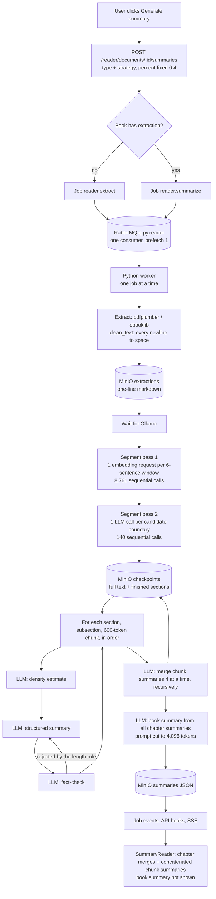
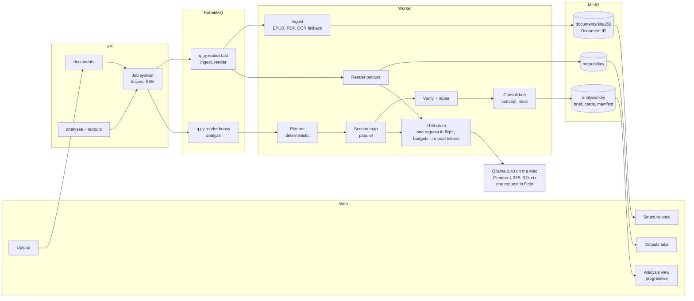
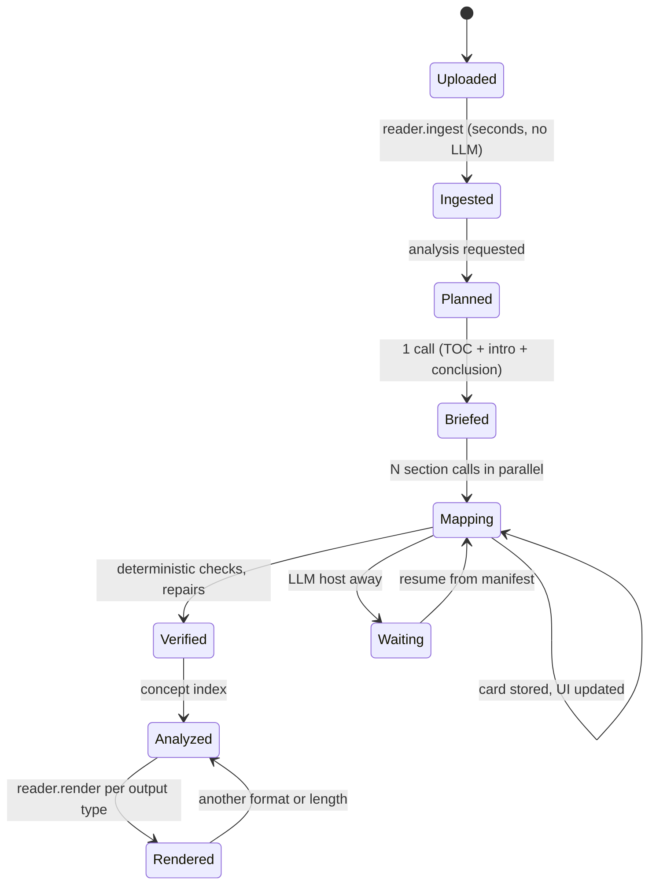
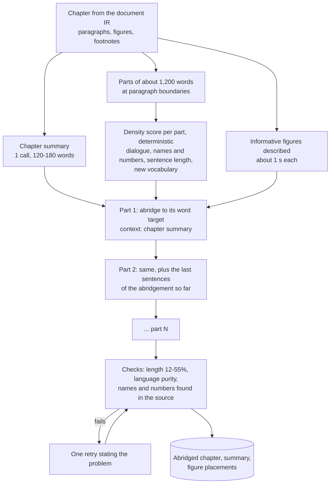
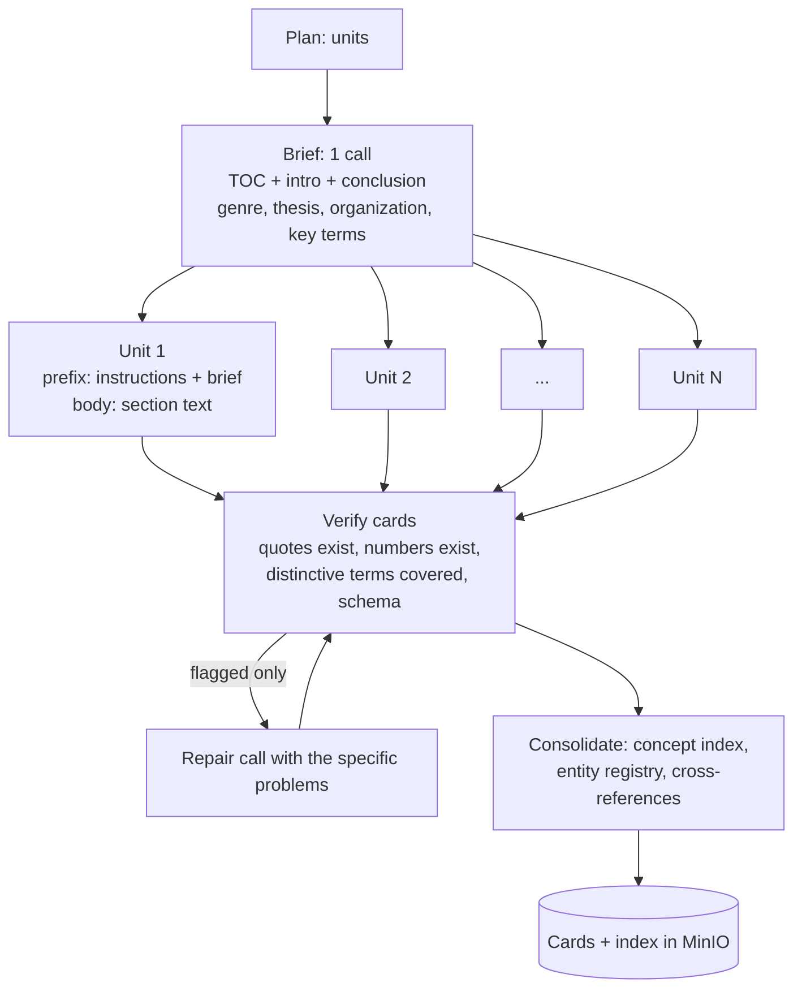
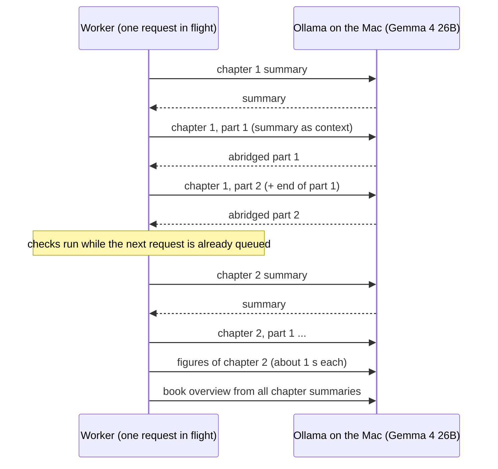

# Book summarization engine: investigation and redesign

Date: 2026-10-30. Status: investigated, then implemented the same evening on branch `summarizer-v2`
(§20). Supersedes the parked notes in `docs/pipeline-speed-backlog.md` (every observation there is
checked below).

**Revision 2 (same day, afternoon).** The owner set the constraints: free (local only, no paid APIs), the
M3 Max as the LLM host, modern English, Russian and Ukrainian books, and as the main product an **abridged
edition**: a short summary per chapter plus the chapter compressed to 15–35% of its length (up to 50% where
the text is dense), keeping the important pictures. With the owner's approval Ollama was upgraded to
0.40.13 and four models were compared on seven chapters in the three languages; pictures, PDFs without
bookmarks and scanned pages were tested. Updated: §1, §8.6, §10, §12, §15, §16. New: §17 (languages),
§18 (pictures), §19 (PDFs without structure, scans), Appendix B (the follow-up measurements). The hosted
engine (§10.4) is out of scope.

How to read the tags:

| Tag | Meaning |
|---|---|
| **[code]** | Verified by reading the code path (file:line given) |
| **[measured]** | Measured on 2026-10-30 on the owner's MacBook Pro M3 Max (48 GB), Ollama 0.11.5, `qwen2.5:14b-instruct-q5_K_M` and `bge-m3`, called from the `workbench-workers` container (ARM64, 1 CPU, 1.5 GB cap). Revision-2 measurements used Ollama 0.40.13 (context 32k, flash attention, one request slot unless stated) with the models of §10, called on the Mac directly |
| **[derived]** | Computed from measured numbers and the code's own parameters; the arithmetic is shown |
| **[hypothesis]** | Engineering expectation that needs the experiment named next to it |
| **[unverified]** | External fact (model, price, release) not checked against a current source in this investigation |

Test books (the owner's own uploads, read from local MinIO): *Antifragile* (Taleb, EPUB, 2.7 MB,
nonfiction), *The Valley of the Moon* (London, EPUB, 0.5 MB, fiction), *Dropout* paper (Srivastava et al.,
PDF, 1.7 MB, 18 pages, technical). Revision 2 added public-domain and freely licensed texts (Appendix B):
Russell, *The Problems of Philosophy* (English); Chekhov, *Остров Сахалин* (Russian, modern spelling);
Apostol, *Московия в представлении иностранцев* (Russian, pre-1918 spelling, 39 pictures); Hrushevsky,
*Про старі часи на Україні* (Ukrainian, 1919 spelling); the Ukrainian Wikipedia article «Хмельниччина»
(modern Ukrainian).

---

## 1. Executive summary

The current summarizer takes hours because its design does far more inference than the task needs,
not because the hardware is slow. Most of that inference is either spent recovering information
the extraction threw away or redone because the validation step rejects correct output.

What the measurements show for *Antifragile* (241k tokens) on the M3 Max:

- **About 5.8 hours** end to end in the default `balanced` mode **[derived]**, from about
  **2,900 LLM generations plus 8,761 embedding requests**, about **2.2M prompt tokens (9× the book)** and
  about **350k generated tokens** (more than the book's own length in tokens, at 27 tokens/s).
- **About half of that time is validation overhead triggered by a bug.** The LLM fact-checker is asked to
  answer "ACCURATE"; the model does, then adds an explanation, and the rule `len(response) < 50`
  (`quality_metrics.py:235`) turns every such answer into "issues". 4 of 4 sampled answers were rejected
  this way **[measured]**, and every chunk of a real pipeline run used both attempts **[measured, 3/3]**.
- **Extraction destroys the book's structure** (every newline becomes a space, `extract/handler.py:27-34`),
  then a segmenter spends about 22 minutes **[derived]** guessing chapters again with 8,761 sequential
  embedding calls and 140 LLM calls. The EPUB already contained a 273-entry table of contents with the
  real chapter titles **[measured]**.
- **Nothing runs in parallel** (`pipeline.py:290`), and the Ollama host serves one request at a time anyway:
  four concurrent requests completed at 9.4, 18.8, 28.2 and 37.6 s **[measured]**.
- **Prompts longer than 4,096 tokens are silently cut.** Ollama 0.11.5 loaded the model with a
  4,096-token context; a 6,242-token prompt on the endpoint the pipeline uses came back as
  `prompt_tokens: 4096` **[measured]**. The prompt that exceeds it is the whole-book summary (all chapter
  summaries in one prompt) **[code]**, so the model sees only part of it; Ollama's runner keeps the end of
  an over-long prompt, which would mean the last chapters and not the instructions **[runner behaviour,
  not measured here]**. The web app does not display that summary anyway (`SummaryReader.tsx` never reads
  `document_summary`) **[code]**.
- The requested summary length is ignored in `balanced` mode **[code]**, about 20% of *Antifragile* is
  bibliography, notes, glossary and similar back matter that get summarized like chapters **[measured]**,
  and the user sees nothing until the whole book is done **[code]**.

**Recommendation: Option 2, replace the summarization core and keep the platform.** The job system,
RabbitMQ, MinIO, API, web shell and the Ollama host on the M3 Max stay. Everything under
`apps/workers/worker/tools/reader/summarize/` (about 8,000 lines) and most of `extract/` is replaced by a
smaller engine that produces what the owner asked for, an **abridged edition**: per chapter a short
summary and the chapter compressed to 15–35% (up to 50% where the text is dense), with its important
pictures. Five ideas:

1. **Parse once into a structured document** at upload time, keyed by the file's SHA-256: real chapters,
   paragraphs, footnotes, pictures with captions, front and back matter. A PDF without bookmarks gets its
   chapters from fonts and layout (90–100% of chapters found on the test PDFs **[measured]**); scanned
   pages are read by the same vision-capable model (≈1% character error on modern Ukrainian **[measured]**).
2. **One chapter pass per real chapter.** A chapter summary, then the abridgement written in parts of about
   1,200 words; each part sees the chapter summary and the end of the text so far, and gets an explicit
   length target from a deterministic density score. With Gemma 4 this gave 23–40% of the original on
   every test chapter, where a single call had produced anywhere from 7% to 35%, and kept twice the names
   and numbers of the too-short single-call versions, with no repetition or visible seams **[measured]**.
3. **Pictures stay.** Decorative images are dropped (and decorative initial letters put back into the
   text), informative ones are described by the same model in about a second each so the text can use
   what they show, and the originals are placed in the abridged chapter with their captions: 14 of 14
   placed in the demo **[measured]**.
4. **Deterministic checks after every part**: length band, language purity (no Russian in Ukrainian
   output), every name and number traced to the source, garbled names corrected to the source form.
   Instead of an LLM grading every paragraph.
5. **The output is a book.** An abridged-edition EPUB added to the library, read with the existing reader,
   highlights and notes; a book overview from the chapter summaries. Other formats come later from the
   same stored artifacts, without re-reading the book.

**Model: Gemma 4 26B** (mixture of experts, 3.8B active parameters, Apple-Silicon MLX build) on Ollama
0.40.13. It was chosen from four candidates on the owner's languages **[measured, §10]**:

- about 3× faster than the current model;
- the only candidate whose output length can be steered;
- fluent modern Ukrainian and Russian without Russianisms;
- about 30% fewer tokens per Cyrillic word.

It also reads pictures and scans. Qwen 3.6 35B is twice as fast again, but does not abridge reliably:
25–99% of the original, even after being told the length was wrong.

**The owner's blind ratings reopen this choice (Appendix B.9).** Rated 1–5 for faithfulness, completeness,
language and readability without knowing the models:

| Candidate | Total (of 20) | Faithfulness | Average length |
|---|---|---|---|
| Qwen 3.6, adaptive parts | 18.5 | 4.2 | 56% |
| Gemma 4, adaptive parts | 16.8 | 4.0 | 29% |
| Qwen 3.6, one call | 16.0 | 3.9 | 44% |
| Gemma 4, one call | 15.4 | 3.3 | 18% |
| Current model | 10.1 | 2.9 | — |

- Parts improved both models.
- Gemma 4 makes more factual distortions than this report's spot checks found: inverted statements,
  wrong attributions, invented details.
- Qwen 3.6's best ratings come at about twice the target length.

The model is therefore decided by one more test at equal length (§10.4).

Expected time per book, everything local and free **[derived from measured chapter times]**:

| Language | Seconds per 1,000 words, serial, M3 Max | *Antifragile*-size book (≈145k words of content) |
|---|---|---|
| English | ≈9–10 s | ≈25 min |
| Ukrainian, Russian | ≈13–16 s | ≈35–40 min |

That compares with ≈6 h today for a lower-quality output. Sending several chapters at once does not shorten this on the Mac: Ollama's MLX runner answered simultaneous requests one after another, with no gain in combined speed **[measured, §10.5]**. The structure is visible
seconds after upload and the first chapters within minutes.

Phase 1 of the roadmap (days, no redesign) already removes about half of today's time (≈5.8 h → ≈2.7 h
**[derived]**). It fixes the validation bug, drops the density call, finishes the Ollama configuration
(the upgrade itself is done) and batches embeddings. It is worth doing first because it also gives the
measured baseline the redesign is compared against.

---

## 2. Current architecture and implementation

### 2.1 Components that take part

| Layer | Where | Role in summarization |
|---|---|---|
| Web | `apps/web/src/tools/reader/summaries/*`, `src/platform/jobs/*` | Generate dialog (type + strategy), progress view (SSE `useJob`), summary reader |
| API | `apps/api/src/tools/reader/{documents,summaries}`, `src/platform/{jobs,queue,storage}` | Upload, summary rows, job rows, job events, hooks, content download |
| Queue | RabbitMQ: `workbench.jobs` → `q.py.reader`; events back on `workbench.job-events` | Delivers job envelopes; carries progress |
| Worker | `apps/workers/worker/platform/*`, `worker/tools/reader/{extract,summarize}` | Extraction and the whole summarization pipeline |
| Storage | MinIO buckets `books`, `extractions`, `summaries`, `checkpoints` | Files, flattened text, summary JSON, checkpoints |
| LLM host | Ollama on the owner's machine over Tailscale (`docs/deploy.md`) | Generation (`qwen2.5:14b-instruct-q5_K_M`) and embeddings (`bge-m3`) |
| Server | Hetzner ARM VPS, 2 vCPU, 3.7 GB RAM; workers capped at 1 CPU / 1.5 GB (`docker-compose.yml:223-224`) | Runs everything except the LLM |

### 2.2 Stage by stage

| # | Stage | Implementation | Input → output | Sequential? | Persisted? | Cost |
|---|---|---|---|---|---|---|
| 1 | Upload | `documents.controller.ts:43-78`, `documents.service.ts:61-121`: multer in memory, `putObject('books')`, SHA-256 computed (`:92`) but never used to deduplicate | file → `reader_book` row + object | — | yes | seconds |
| 2 | Request | `summaries.controller.ts:27` passes type + strategy only; `summaries.service.ts:47-124` creates `reader_summary`, a `reader.extract` job (only if no extraction yet) and a child `reader.summarize`; percent is always 0.4 (`:19`) | click → 1–2 jobs on `q.py.reader` | — | Job rows | ms |
| 3 | Consume | `platform/queue.py:59-72`: ack on claim, handler runs synchronously in the pika callback; one consumer per tool (`__main__.py:52-57`), prefetch 1; **both job types share one queue** (`handlers.py:12`) | envelope → handler | **one job at a time** | Job row via events | — |
| 4 | Extract | `extract/handler.py:58-102`; PDF: pdfplumber page by page (`pdf_extractor.py:51-60`) with `--- Page N ---` markers; EPUB: ebooklib items in **manifest order** (`epub_extractor.py:56-59`), file name as "chapter title" (`:81`), sentences under 10 characters dropped (`:161-177`); then `clean_text` turns **every newline into a space** (`handler.py:27-34`) | file → one-line markdown in `extractions/extraction/<bookId>_extraction.md` | per page / item | yes | 0.1–0.5 s per sample book **[measured]** |
| 5 | Wait for LLM | `summarize/handler.py:152`, `platform/llm.py:64-80`: probes `/api/tags`, reports `waiting` with backoff | — | — | Job status | — |
| 6 | Segment | `segmentation/segmenter.py`: NLTK sentences → windows of 6 sentences with stride 1 → **one `/api/embeddings` request per window** (`:63`, `ollama_client.py:29-47`) → cosine shift + rolling z-score peaks → merge/min-gap filters → **one LLM JSON call per candidate** (`:84-89`, `llm_verifier.py:83-118`) → length rules and title calls (`consistency.py`) | text → sections/subsections with LLM-invented titles | **fully sequential** | yes, inside the checkpoint (`handler.py:229-235`) | 22 min for *Antifragile* **[derived]** |
| 7 | Chunk | `chunking/token_chunker.py`: 600 tokens, 15% overlap, regex sentences | subsection → chunks | — | no | ms |
| 8 | Per chunk | `pipeline.py:290-305`: density estimate (**LLM call**, `density_analyzer.py:214-229`) → summary (`strategies.py:94-147`, running context = truncated previews of earlier summaries, `running_context.py:188`) → validation loop (`validation_loop.py:130-185`: lexical coverage, heuristic coherence, **LLM fact-check**, regenerate up to 2× in `balanced`) | chunk → chunk summary | **strictly sequential** (`await` per chunk) | no (only per section) | 31.6 s per chunk **[derived]** |
| 9 | Dedup | `overlap_deduplicator.py:199-230`: difflib between neighbouring summaries | summaries → summaries | — | no | ms |
| 10 | Merge | `pipeline.py:436-444` → `hierarchical_merger.py:139-261`: all chunk summaries of a section merged in batches of 4, recursively, one call at a time | summaries → chapter summary | sequential | per section | ~50 min **[derived]** |
| 11 | Checkpoint | `handler.py:270-275`, `checkpoint/manager.py:131-165`: whole checkpoint (segmentation including the full text, plus finished sections) re-uploaded after every section; key `checkpoint/<bookId>_<type>.json` (`:129`) | — | — | yes | small |
| 12 | Book summary | `pipeline.py:462-482` → `hierarchical_merger.py:289-345`: **all chapter summaries in one prompt** | chapter summaries → document summary | — | in result | 1 call, truncated **[measured mechanism]** |
| 13 | Store | `handler.py:197-206`: summary JSON to `summaries/summary/<bookId>/<summaryId>.json`, checkpoint deleted | — | — | yes | — |
| 14 | Report | `platform/events.py` → API `JobsService.applyEvent` (`jobs.service.ts:294-400`), `ReaderJobHooks` sets `storageKey`; SSE `GET /jobs/:id/stream` → `useJob` | events → Job row → UI | — | Job row + timeline | — |
| 15 | Display | `SummaryReader.tsx:69-110`: per chapter its merged summary, per subsection its chunk summaries concatenated; `document_summary` and `entity_registry` are never rendered | JSON → pages | — | — | — |

### 2.3 Facts about the configuration in use

- Preset `balanced` (`pipeline_builder.py:346-361`): running context, adaptive compression, validation
  (2 attempts), dedup and hierarchical merge on; entity tracking and semantic chunking off; strategy
  `structured`. **[code]**
- The strategy picker in the UI selects `basic`, `structured`, `two_pass` (2 calls per chunk),
  `chain_of_density` (writes 3 summaries and keeps the third, `strategies.py:318-398`) or `hybrid` (2 calls).
  Each multiplies the work above. **[code]**
- `llm_max_concurrent = 5` (`config/settings.py:41`) is never reached: nothing issues concurrent requests. **[code]**
- The LLM client uses `/v1/chat/completions` (`async_client.py:141`) and cannot set the context length;
  the segmenter uses `/api/generate` and `/api/embeddings` without it either. **[code]**

---

## 3. Processing flow diagram (as implemented)



---

## 4. Confirmed performance bottlenecks

### 4.1 Where the time goes (*Antifragile*, `balanced`, M3 Max)

Measured unit costs **[measured]**: summary call 10.5 s (915 prompt tokens, 195 generated), fact-check
4.6 s (700 / 58), density 1.45 s (394 / 3), segment verification 4.5 s, embedding request 77 ms;
prompt processing about 295 tokens/s, generation about 27 tokens/s; cold model load 5.3 s.

Counts from the code applied to the book **[derived]**: 8,761 windows; 140 candidate boundaries
**[measured]**; about 520 chunks (476 if the book were one subsection; per-subsection remainders add
more); 2 attempts per chunk (fact-check rule, §4.3); about 185 merge calls (≈ chunks / 3 with batches of 4).

| Step | Calls | Time | Share |
|---|---|---|---|
| Extraction, cleaning, I/O | — | < 1 min | ~0% |
| Segmentation, embeddings | 8,761 | 11.2 min | 6% (with pass 2) |
| Segmentation, LLM verification | 140 | 10.6 min | |
| Density estimates | 520 | 12.6 min | 4% |
| Chunk summaries (2 attempts) | 1,040 | 182 min | 52% |
| Fact-checks | 1,040 | 79 min | 23% |
| Merges | ~185 | ~52 min (≈17 s each, not measured) | 15% |
| Book summary | 1 | ~2 min | <1% |
| **Total** | **≈2,900 + 8,761 embeddings** | **≈5.8 h** | |

Cross-check: about 2.2M prompt tokens ÷ 295 tok/s ≈ 2.1 h, plus about 350k generated tokens ÷ 27 tok/s
≈ 3.6 h, plus 11 min of embeddings ≈ 5.9 h. The two estimates agree. The owner's "up to 12 hours" fits
longer books, the Tailscale round trip on about 11,700 requests, and a laptop that sleeps or throttles.

### 4.2 Confirmed bottlenecks

1. **Generation volume.** About 350k generated tokens for a 241k-token book. In local inference, decoding
   (27 tok/s) dominates, so the size of what is generated matters more than chunking. Even a perfect
   implementation of today's design produces a 30–40% paraphrase of the book (≈72–97k tokens, 45–60 min
   of decoding alone). **[derived]**
2. **Validation overhead.** Second attempts plus fact-checks are about 170 of 350 minutes. **[derived from
   measured unit costs and 3/3 observed double attempts]**
3. **Strict serialization.** One chunk at a time (`pipeline.py:290`), one merge at a time
   (`hierarchical_merger.py:253-255`), one embedding at a time (`segmenter.py:63`). **[code]** And the
   server serializes too: 1 slot **[measured]**.
4. **Redundant embeddings.** Windows of 6 sentences with stride 1 embed every sentence 6 times;
   8,761 windows × 200 tokens ≈ 1.75M embedding tokens (7× the book). Batching alone cuts the request cost
   from 77 to 27.6 ms per window (whole book: 674.6 s → 242.2 s **[measured]**).
5. **Structure re-derivation.** 22 minutes of segmentation to approximate what the EPUB TOC states. **[derived]**
6. **Head-of-line blocking.** Extraction of any other book waits behind a multi-hour summarization
   because both job types share one queue and one consumer thread. **[code]**

### 4.3 Defects found on the way (correctness and quality)

| # | Defect | Evidence |
|---|---|---|
| D1 | Fact-check rejects correct summaries: `"ACCURATE" in r and len(r) < 50`; extra lines count as "issues", score ≤ 0.6 < 0.7 required | `quality_metrics.py:235`, `validators.py:177-182`; 4/4 replies 177–392 chars **[measured]**; 3/3 chunks failed both attempts **[measured]** |
| D2 | Fact-check sees only the first 2,000 characters of a ~2,600-character chunk | `quality_metrics.py:218` **[code]** |
| D3 | Prompts over 4,096 tokens silently truncated; the book summary prompt (all chapter summaries) exceeds it | `async_client.py:141` (no context setting), `hierarchical_merger.py:322-340`; 6,242 → 4,096 tokens **[measured]**; which part survives was not measured |
| D4 | Requested percent ignored: adaptive ratio is computed around a fixed 0.3 (`adaptive_compressor.py:134`), `base_ratio` and `summaryPercent` never enter it | **[code]** |
| D5 | Position adjustment broken: `chunk_index` counts across the whole book, `total_chunks` is per subsection, so almost every chunk gets the "last 10%" boost | `running_context.py:79,114`, `adaptive_compressor.py:77-85` **[code]** |
| D6 | On an unusable LLM answer, the "summary" silently becomes the original chunk text | `context_summarizer.py:209-223`, `chunk_summarizer.py:98-112` **[code]** |
| D7 | Coverage and density metrics only see ASCII letters: for Ukrainian text the coverage check always passes | `quality_metrics.py:58`, `density_analyzer.py:64` **[code]** |
| D8 | Segment verifier asks for `offset_sentences` and `confidence` and ignores both | `llm_verifier.py:105-109` **[code]** |
| D9 | EPUB items read in manifest order, not reading (spine) order | `epub_extractor.py:56`; mismatch present in *The Valley of the Moon* (only cover vs TOC there) **[measured]** |
| D10 | Page markers, file names and front/back matter go into the text the LLM summarizes | `pdf_extractor.py:60`, `epub_extractor.py:82`; *Antifragile*: ~20% back matter **[measured]** |
| D11 | Book summary never shown; entity registry never shown | `SummaryReader.tsx:69-110` **[code]** |
| D12 | Checkpoints keyed by book and type, not by summary: two requests with different parameters delete each other's checkpoint | `checkpoint/manager.py:129`, `handler.py:222-228` **[code]** |
| D13 | Segmenter read timeouts (60 s) are not recognised as "host away", so a slow model load fails the job and segmentation restarts from zero | `ollama_client.py:62`, `platform/llm.py:18-61` **[code]** |

---

## 5. Missing capabilities

- Use of the document's own structure (EPUB nav/NCX, PDF outline, headings, paragraphs, footnotes).
- OCR for scanned PDFs (today: "No text could be extracted", `extract/handler.py:84-85`).
- Detection and exclusion of non-content (copyright, TOC, bibliography, index, notes).
- Any intermediate representation that can be reused: each summary request re-segments and re-summarizes
  the book; a different length or format means a full re-run.
- Output types other than "hierarchical paraphrase": no executive summary in the UI, no key concepts,
  arguments with evidence, takeaways or cross-chapter relationships.
- Partial results: time to first useful output equals total time.
- Traceability from a summary statement back to the place in the book.
- Language awareness (prompts say "same language", metrics are English-only, budgets use an OpenAI tokenizer).
- A benchmark and quality-evaluation harness; per-call token accounting.
- A choice of model per job (revision 2: one local model is enough; hosted engines are out of scope).
- Content-hash deduplication of identical uploads.

---

## 6. Architectural weaknesses

1. **Information is destroyed early and reconstructed expensively.** Structure is flattened at extraction
   and then approximated with embeddings and LLM calls. The resulting chapters are topic shifts with
   invented titles, so the summary's table of contents does not match the book's.
2. **The abstraction is the 600-token chunk.** It was sized for 2k–4k context models. It forces about 500
   calls, gives each call too little context to see an argument, and makes the "summary" a long
   paraphrase that is then compressed again (chunk → merge → merge → chapter → book: four or five lossy
   levels).
3. **Continuity by serialization.** The running context (truncated first 210 characters of earlier
   summaries) adds little information but forces every chunk to wait for the previous one.
4. **Quality control by LLM self-grading.** Each chunk is graded by the same model with a brittle parser
   and an English-only lexical metric, and regenerated. It is expensive, noisy and adds no grounding.
5. **No separation between understanding and presentation.** Strategy, length and format are baked into
   the single pass over the book, so every variation costs the full price.
6. **One worker thread for light and heavy jobs.** Inference workloads need a scheduler that knows the
   server's capacity; today there is none, and the server itself was left at 1 slot and 4k context.
7. **Many knobs without measurements.** About 40 settings and 8 feature flags interact; no measurement
   existed to tell which ones help.

Unnecessary complexity (can go): semantic chunking, entity tracker, adaptive compression and density
analysis, validation loop, overlap dedup, four of five strategies, paragraph formatter, segmenter.

What is good and should stay: the job platform (ack on claim, leases, heartbeats, `waiting`, timeline,
SSE), DB-free workers, MinIO, the waiting-for-host behaviour, the progress event contract.

---

## 7. Alternative approaches explored

| Approach | What it means here | Verdict |
|---|---|---|
| Optimized chunk map-reduce (today, fixed) | Same pipeline without the defects | ≈2.7 h after the quick wins, ceiling ≈1.5–2 h for *Antifragile* **[derived]**; output is still a paraphrase |
| Hierarchical / recursive merging | Today's merge tree | Each level loses detail; depth is a property of chunk size, not of the book. Keep at most one reduce level |
| Incremental "refine" (one pass, carry a running summary) | Sequential by nature | Good for fiction state, too slow for nonfiction; use only as a light chapter-level state for narratives |
| **Structure-aware section map + one reduce** | One call per real section, parallel; reduce over compact cards | **Chosen.** Reads each token once, keeps chapters intact, parallel |
| **Knowledge-centric intermediate (section cards)** | JSON records of claims, evidence, concepts, quotes | **Chosen.** Less loss than prose, deterministically checkable, reusable for every output |
| Adaptive compute | Skip non-content; size units by budget; repair only flagged units; output length by importance | **Chosen**, mostly deterministic |
| Direct long-context summarization | Whole book in one prompt | Not locally: 241k prompt tokens at 295 tok/s is 14 min per output and local quality at that length is unproven. Worth testing hosted (experiment E7) for small/medium books |
| RAG with a vector database | Embed passages, retrieve during synthesis | Not needed for summaries (cards already carry the content). Useful later for Q&A and for verifying final claims. A book has ~6k paragraphs: brute-force cosine in NumPy is instant, no vector DB |
| Knowledge graph | Entities and relations as a graph store | Overkill. A concept index (concept → sections, definition, mentions) built from the cards gives the cross-chapter links |
| Streaming / incremental | Results as sections finish | **Chosen** for delivery (progressive UI) |
| Multi-model routing | Small model for bulk, strong model for synthesis | **Chosen** as an option; synthesis is ~10% of tokens, so a stronger or hosted model there is cheap |
| Agentic multi-step (planner/critic agents) | Many LLM calls deciding what to do | Rejected: adds calls and variance; the plan is deterministic from the structure |

The deciding principle: in local inference, cost ≈ prompt tokens ÷ 295 + generated tokens ÷ 27
(seconds, current model). Everything that does not reduce those two numbers is secondary.

---

## 8. Proposed architecture

### 8.1 Overview



### 8.2 Book lifecycle



### 8.3 Ingest: one normalized document per file

- Runs on upload (`reader.ingest` on the fast queue), not on the first summary request.
- **EPUB**: spine for reading order; EPUB3 nav or EPUB2 NCX for the TOC (ebooklib reads both); blocks per
  `h1–h6`, `p`, `li`, `blockquote`, `table`, `figcaption`; footnotes and note references kept
  (`epub:type`); landmarks/TOC titles classify front and back matter. Measured cost today is under 0.3 s.
- **PDF**: outline (bookmarks) for the TOC; text spans with font size and weight for headings when there is
  no outline; running headers and footers removed by repetition across pages; de-hyphenation; page
  numbers kept as locations, not as text. PyMuPDF does all of this quickly (AGPL licence, acceptable for a
  private self-hosted tool **[unverified for your use]**); pypdfium2 is already installed
  (17× faster than pdfplumber on the sample **[measured]**) and is the permissive fallback for plain text.
- **Scanned PDF**: detect pages without a text layer and read them with the same model on the Mac (§19).
  This is Phase 4 because the current system has no OCR at all.
- **Large files (50–150 MB)**: process page by page, never rasterize unless OCR is needed; memory stays
  flat. **[hypothesis, E8 measures peak RSS]**
- **LLM fallback for structure** only when neither TOC nor headings exist: one call over a compact
  skeleton (candidate heading lines with positions), not one call per boundary.

### 8.4 Planner (deterministic)

```python
def plan(doc: Document, budget: int = 10_000, min_unit: int = 1_500) -> list[Unit]:
    """Real sections become work units of roughly `budget` tokens."""
    units, current = [], []
    for section in doc.leaf_sections():                # TOC order = reading order
        if section.kind in SKIP_KINDS:                  # copyright, toc, index, bibliography, about-the-author
            continue
        if section.tokens > budget:                     # split at paragraph boundaries, keep the heading
            units += split_by_paragraphs(section, budget)
            continue
        if current and (sum_tokens(current) + section.tokens > budget
                        or section.chapter != current[-1].chapter):
            units.append(Unit(current)); current = []
        current.append(section)                         # small sections of one chapter travel together
    if current:
        units.append(Unit(current))
    return merge_tiny(units, min_unit)
```

*Antifragile*: 241k tokens minus ≈50–60k of bibliography, notes and glossary leaves about 185k tokens, or
about 20–25 units. *The Valley of the Moon*: 57 chapters with a median of ~4k tokens **[measured]**; one unit
per chapter (fiction keeps chapter granularity), or two chapters per unit for speed.

### 8.4a Chapter pass: summary and abridged chapter (revision 2, the primary path)

The owner's product is the abridged edition, so the unit of work is the real chapter, and the first thing
the engine produces per chapter is its summary and its abridgement. The section cards of §8.5 become a
secondary layer for book-level outputs (§8.6), built later and only if wanted.



Every rule in this pass comes from a measurement (Appendix B):

- **Parts, not one call per chapter.** One call per ~4,000-word chapter produced 7% to 35% of the original
  with no way to steer it, and the shortest versions kept only 14–18% of the chapter's names and numbers.
  In parts of ~1,200 words, Gemma 4 produced 23–40% on all seven test chapters (no retry needed), coverage
  of names and numbers doubled where the single call had been too short, and there was no repetition and
  no "in this part" seam. **[measured]**
- **Context per part**: the chapter summary and the last two sentences of the abridgement so far. The joins
  read as one text. **[measured, read by hand]**
- **Length from a deterministic density score, not from the model's opinion.** Asked to label each part
  LIGHT, NORMAL or DENSE and size it accordingly, Gemma 4 said NORMAL for all 17 parts (dense philosophy
  included) and Qwen 3.6 said DENSE for most and overshot. **[measured]** So each part gets an explicit
  word target from a score: base 25%; toward 15–20% for dialogue-heavy, anecdotal or repetitive text; toward
  40–50% for parts dense in names, numbers, definitions, long sentences or vocabulary new to the book.
  **[hypothesis: calibrate the score on the corpus, Phase 2]**
- **Order**: parts of a chapter run in sequence (each needs the previous ending); chapters run in parallel
  one after another with one request always in flight (§8.7).
- **Figures**: an informative figure enters its part as `[[FIG n: caption — description]]`; the model keeps
  `[[FIG n]]` where the picture belongs (14 of 14 in the demo **[measured]**); a missing marker is
  re-inserted after the paragraph that referenced the figure.
- **Very long chapters**: when a chapter does not fit the summary call's budget, its summary is made from
  the part abridgements instead.
- **Cost with Gemma 4**: ≈9–10 s per 1,000 English words, ≈13–16 s per 1,000 Russian or Ukrainian words,
  summary call included. **[measured on the test chapters]**

### 8.5 Analysis cards: brief, map, verify, consolidate (secondary, for book-level outputs)



- **Brief** first (one call, ~10k tokens in, ~800 out). It gives every unit call the book-level context
  that the running context was meant to give, without serializing anything. It is also an identical prefix
  for all unit calls, which lets the server reuse its KV cache for that prefix.
  **[hypothesis, E5 and E1]**
- **Map**: one call per unit with a JSON schema for the output (Ollama `format` with a schema; the OpenAI
  `response_format` for hosted providers). Units run in parallel up to the server's slot count, in reading
  order, so early chapters arrive first.
- **Narrative profile** (fiction): chapters run in order with a compact story state (characters and their
  states, open threads, ~500 tokens) handed from chapter to chapter. That is sequential, but it means
  57 calls for *The Valley of the Moon*, not ~440 chunks × 5. Experiment E6 decides whether the state is
  worth the serialization.
- **Verify** without an LLM: every quote must occur in its section (normalized match); every number in a
  claim must occur in the section; card fields within budget; the section's most distinctive terms
  (TF-IDF against the other sections) should appear among the card's concepts or claims. Only units with
  problems get one repair call that lists the problems.
- **Consolidate** without an LLM: concepts merged across units by normalized name (and, optionally,
  bge-m3 similarity on a few hundred names in one batched request); each concept points to where it is
  defined and used.

### 8.6 Outputs

| Output | How | LLM calls |
|---|---|---|
| **Abridged edition (EPUB, the main product)** | Per chapter, in TOC order: title, summary box, abridged text with the original figures and captions; front page with the book overview. Added to the library, so the reader, highlights and notes work on it. A one-chapter demo was built and renders correctly (Appendix B.6) | 0 beyond the chapter passes |
| Book overview | From the chapter summaries (≈150 words × chapters) → 500–800 words | 1 |
| Chapter by chapter | Assembled from each card's `summary`, in TOC order | 0 (optional polish per chapter) |
| Key concepts and definitions | From the concept index | 0 |
| Executive summary | Cards (≈20–30k tokens for *Antifragile*) → 600–900 words | 1 |
| Main arguments and evidence | Claims of kind thesis/argument/evidence grouped by concept → narrative | 1 |
| Practical takeaways | Card takeaways, deduplicated and ranked | 1 |
| Cross-chapter relationships | Concept index + links | 1 |
| Comprehensive summary | Cards → long form, by part if the cards exceed the context | 1–4 |

Each output is a `reader.render` job keyed by (analysis key, output type, parameters). Re-rendering with
another length or language reads only the cards. If the cards of a very long book exceed the context, the
reduce runs per part (Book I, II, III) and once more over the parts: depth stays at most two.

### 8.7 Execution on the Mac: one request in flight, no gaps

Revision 1 planned 2–4 simultaneous requests: decoding is limited by memory bandwidth, so batched
sequences should share the cost of reading the weights. The measurement says otherwise for today's
Ollama MLX runner. Four simultaneous chapter requests finished at 15, 31, 60 and 86 s, with no gain in
combined speed, for both Gemma 4 and Qwen 3.6 **[measured, §10.5]**. So the worker keeps exactly one
request in flight and never lets the GPU idle:



- Each chapter's parts run in order, because a part needs the end of the previous one. Chapters follow
  one another, with figures described in the gaps.
- The deterministic checks take milliseconds and run while the next request is already with the server.
- If a future Ollama batches simultaneous requests on Apple Silicon (re-test, step 3.3), chapters can run
  side by side without any other change.
- Memory is not a constraint with one request in flight: the 18 GB model plus a 32k context ran
  entirely in GPU memory **[measured]**.

### 8.8 Orchestration

- Keep RabbitMQ and the Job table for the job lifecycle; do not put sections on the queue. One user and one
  GPU are scheduled better in process: one request in flight (§8.7), with per-chapter
  results persisted in MinIO for resumability.
- Two queues for the reader: `fast` (ingest, render: seconds to minutes) and `heavy` (analyze), with one
  consumer thread each, so nothing waits behind a book.
- A `manifest.json` per analysis records each unit's state (pending, done, degraded), model, prompt
  version and token counts. Resume = skip done units. The current checkpoint and `waiting` logic map onto
  it directly.

### 8.9 Storage and caching

| Artifact | Key | Reused when |
|---|---|---|
| Original file | `books/<storageKey>` (today) | — |
| Document IR | `documents/<sha256>/ir-v1.json.gz` | Same file uploaded again; any analysis |
| Brief, cards, manifest, concept index | `analysis/<analysisKey>/...` with analysisKey = hash(sha256, IR version, profile, model, prompt version) | Any output; resume after failure |
| Outputs | `outputs/<analysisKey>/<type>-<paramsHash>.json` | Same request again |
| Paragraph embeddings (optional) | `embeddings/<sha256>/<model>.npy` | Q&A, verification |

The upload's existing SHA-256 (`documents.service.ts:92`) becomes the document key. Deleting a book
deletes its prefixes (as `deleteForBook` does today).

### 8.10 Failure handling

- Transport errors: retry with backoff; host away: the existing `waiting` state, then resume from the
  manifest.
- Invalid JSON: one repair attempt with the schema errors; then mark the unit `degraded` (shown as such in
  the UI). Never substitute the source text for a summary (today's D6).
- Truncation: compare the planned token count with the server's `prompt_eval_count`; fail the unit loudly
  if they differ.
- Idempotency: unit results keyed by unit text hash; outputs keyed by parameters; a re-delivered job finds
  its work done.

### 8.11 Progress and frontend

- Progress reports units done / total and an ETA from the host's measured tokens per second.
- The structure (real TOC, sizes, which parts are skipped) is visible right after upload.
- The analysis view lists chapters with status; each card appears when it is done.
- Output tabs: Executive, Chapters, Concepts, Arguments, Takeaways, Connections; each is rendered on first
  open and cached.
- Every claim and quote links to its location in the reader (block → EPUB href or PDF page).
- The strategy picker goes. In its place, "Make abridged edition" with two choices:
  - average compression (default ≈25–30%, density decides per part within 15–50%);
  - key figures or all figures.
- Per-chapter progress, and the finished edition opens in the reader.

### 8.12 API boundaries

| Endpoint | Purpose |
|---|---|
| `POST /reader/documents/upload` | as today, plus a `reader.ingest` job |
| `GET /reader/documents/:id/structure` | TOC, sizes, kinds, language |
| `POST /reader/documents/:id/analyses` `{ profile?, engine? }` | idempotent on the analysis key; creates a `reader.analyze` job |
| `GET /reader/analyses/:id` | state + manifest (per-unit status) |
| `GET /reader/analyses/:id/units/:unitId` | one card |
| `POST /reader/analyses/:id/outputs` `{ type, length?, language? }` | idempotent; creates a `reader.render` job |
| `GET /reader/outputs/:id` | output content with source locations |

Workers stay DB-free; rows (`reader_analysis`, `reader_output`) belong to the API. The Job contract is
unchanged.

### 8.13 Scalability

The axis that matters for a personal tool is book size and number of outputs, not users. Work grows
linearly with book tokens at ≈9–16 s per 1,000 words on the M3 Max. A sleeping Mac pauses a book (the
existing `waiting` state) and it resumes from the last finished chapter. Multi-user fairness (per-user queues) can be added to the job system later
without touching the engine.

### 8.14 Why each decision beats the current one

| Decision | Replaces | Why |
|---|---|---|
| Parse structure once into an IR | Flatten, then segment with 8,900 requests | Exact chapters for free; 22 min → < 1 s |
| Section-sized units (6–12k) | 600-token chunks | ~25 calls instead of ~500; arguments stay in one context |
| Cards (structured JSON) | Prose chunk summaries merged 4 levels deep | Generated tokens drop ~10×; less loss; checkable; reusable |
| Deterministic verification | LLM self-grading + regeneration | Removes ~half of today's time; adds real grounding (quotes, numbers) |
| Brief as shared prefix | Sequential running context | Same continuity, full parallelism, KV prefix reuse |
| Outputs from cards | One format per full pass | New format in minutes; no re-reading |
| Fast/heavy queues | One queue, one thread | Uploads never wait behind a book |
| Configured host (Ollama 0.40, 32k context, Gemma 4) | 4k context, `qwen2.5` | No silent truncation; ≈3× faster calls **[measured]** |

---

## 9. Comparison of the three directions

| Dimension | Option 1: optimize existing | Option 2: replace the core, keep the platform (**recommended**) | Option 3: new engine and service |
|---|---|---|---|
| Performance potential | ≈2× (≈5.8 h → ≈2.7 h for *Antifragile*), ceiling ≈1.5–2 h because the output is still a 30–40% paraphrase **[derived]** | ≈14× with Gemma 4: ≈25 min for the English *Antifragile* **[derived from measured chapter times]** | Same ceiling as Option 2 (inference-bound) |
| Summary quality | Slightly better (no truncation, no false retries); invented chapters remain | Better: real structure, grounded claims, cross-chapter synthesis, multiple outputs | Same as 2 unless adding agents/graphs of unproven value |
| Inference cost | ≈850–1,400 calls, ≈0.8–1.2M prompt tokens | ≈150 calls (a summary per chapter, one call per ≈1,200-word part), ≈2× the book read, ≈25–35% of the book generated (the product itself) | Similar to 2, higher if agentic |
| Infrastructure cost | None new | None new; optional pay-per-use API | New service, possibly vector/graph stores |
| Implementation complexity | Days | 2–4 weeks for one developer, phased | 4–8+ weeks plus re-integration (auth, jobs, storage, UI) |
| Scalability | Poor for large books (sequential, linear in chunks) | Good (linear in book length at ≈9–16 s per 1,000 words; resumable per chapter) | Good but unneeded |
| Maintainability | 8k lines of interacting heuristics stay | An estimated ~2k lines with clear stages and deterministic checks | Two systems for one person |
| Long-term flexibility | Low (each format = full pass) | High (new outputs, Q&A on the same artifacts) | Highest in theory |
| Main risks | Low risk, low ceiling | JSON reliability of local models (schema-constrained output + repair), unit-size tuning, evaluation effort | Over-engineering, long time to value |

Option 2 replaces essentially all of the summarization code (segmentation, chunking, context, compression,
validation, strategies, merging, orchestration) and most of extraction. What it keeps is what was rebuilt
and hardened in October: the job platform, storage, API and web shell. Option 3 would additionally replace
those without any performance or quality gain, because the gain comes from what the engine computes, not
from where it runs.

Phase 1 (Option 1's quick wins) comes first anyway: cheap, it ships improvements to the current users of
the feature (you), and it produces the baseline.

---

## 10. Models and inference infrastructure

### 10.1 Constraints and what was done

- **Free and local**: everything runs on the M3 Max (48 GB) through Ollama; no paid API. The GPU can use
  most but not all of the 48 GB (macOS default limit; `iogpu.wired_limit_mb` is 0 on this Mac
  **[measured]**), so one large model at a time.
- **Ollama upgraded 0.11.5 → 0.40.13** (Homebrew, 2026-10-30, with the owner's approval). The endpoints the
  current worker uses still answer: `/api/embeddings`, `/api/embed`, `/v1/chat/completions`, and
  `/api/generate` with `format: json` **[measured]**. The current pipeline keeps working unchanged.
- **The library has moved on.** On 2026-10-30 the Ollama library lists Gemma 4, Qwen 3.5, 3.6 and 3.8,
  Nemotron 3.5, gpt-oss and others; the candidates of revision 1 (Qwen3, Gemma 3) are a generation old.
- **Runtime**: on Apple Silicon, Ollama 0.40 serves these models as MLX builds. `gemma4:12b` and
  `gemma4:12b-mlx` resolve to the same files (`safetensors`, `nvfp4`) **[measured]**, so there is no separate
  llama.cpp build to compare for them.

### 10.2 Candidates tested

| Model | Architecture | Parameters | Format | Context | Reads images | Size |
|---|---|---|---|---|---|---|
| `qwen2.5:14b-instruct-q5_K_M` (current) | dense | 14.8B | GGUF Q5_K_M | 32k | no | 10 GB |
| `gemma4:26b-mlx` | mixture of experts, 3.8B active (8 of 128 experts + 1 shared) | 26.2B | MLX `nvfp4` | 256k | yes | 18 GB |
| `qwen3.6:35b-mlx` | mixture of experts (`qwen3_5_moe`) | 36B | MLX `nvfp4` | 256k | yes | 23 GB |
| `gemma4:12b-mlx` | dense | 12.4B | MLX `nvfp4` | 256k | yes (and audio) | 7.7 GB |

Sources: `ollama show` on the Mac **[measured]**; the 3.8B active parameters from the Gemma 4 library
page.

### 10.3 Results

The same prompt for every model: a 120–180-word summary plus an abridgement of about 25%, one call per
chapter, on seven chapters (two English, two Russian, three Ukrainian, 3,000–4,800 words each). Then the
adaptive parts of §8.4a for the two strongest. Full numbers in Appendix B.

| | `qwen2.5:14b` (current) | Gemma 4 26B | Qwen 3.6 35B | Gemma 4 12B |
|---|---|---|---|---|
| Reading speed (prefill) | 263–313 tok/s | 872–1,280 tok/s | 1,098–1,518 tok/s | 416–460 tok/s |
| Writing speed (decode) | 18–22 tok/s | 52–77 tok/s | 106–150 tok/s | 44–63 tok/s |
| One ~4k-word chapter, one call | 45–369 s | 20–65 s | 19–45 s | 67–159 s |
| Length, one call (target 25%) | 3–80% | 7–35% | 11–99.6% | 62–99.6% |
| Length, adaptive parts | — | **23–40%** | 43–68%, ignored the retry | — |
| Ukrainian / Russian language | errors: «Річ Посполита вислав», «Суботу» for Суботів, a false fact («взяли Львів» in August 1648) | fluent, modern, no Russianisms; ≈1–2 slips per 600–1,000 words (a garbled name, a case ending) | fluent, close to the source's own wording | copies the source's wording and spelling |
| OCR, character error (modern Ukrainian / English) | — | 0.2–1% / 0.3–1.4%, 6–8 s per page | 0.1–0.5% / 0.2–1%, 4–10 s per page | 10–22 s per page |
| Decorative vs content picture (4 cases) | — | 4 of 4 | 2 of 4 | 3 of 4 |
| Tokens per Ukrainian word, input (English ≈1.25 for all) | 3.0–3.8 | 2.1–2.6 | 2.2–2.8 | 2.1–2.3 |

All **[measured]**. Quality was judged by reading the outputs against the sources (names, dates, facts,
language), not by an automatic score; a blind side-by-side page for the owner's own judgement is in
Appendix B.7.

### 10.4 Decision

**Provisional, reopened by the owner's blind ratings (Appendix B.9).**

- Qwen 3.6 with adaptive parts was rated best (18.5 of 20) but at 56% length.
- Gemma 4 with adaptive parts came second (16.8) at 29%, with more factual distortions than first
  reported.

The settling test compares the two at matched length (≈30%): Qwen 3.6 with stronger length control
against Gemma 4 with a faithfulness check by a second model. Both are then rated blind against full source
texts.

**Round 3 result so far (Appendix B.11)**:

- **Qwen 3.6 is out.** Even with explicit word and sentence targets and a dedicated shorten pass, it
  produced 42–58% where the targets were 27–39%. Asked to shorten its own draft, it returned the same text.
- **Gemma 4 follows explicit targets.** It produced 26–36%, inside the owner's band.
- **The check-and-fix step works but costs about twice the generation time.** Qwen 3.6 checks each part,
  noise is filtered and Gemma confirms each remaining flag before fixing. It fixed 10 sentences, four of
  them real factual errors; two of those were errors the owner had annotated in round 2, repeated by the
  improved Gemma.
- **Decided by the owner's round-3 ratings** (blind, full sources shown):
  - **Gemma 4 + check: 17.0 of 20**, faithfulness 4.3, length "right" in all three chapters.
  - **Gemma 4 alone: 16.3**, faithfulness 3.7, length right ×3.
  - **Qwen 3.6: 14.0**, readability 2.7, "too long" ×3.
  - The check raised faithfulness exactly where Gemma had erred (Russian 3 → 4, Ukrainian 3 → 4) and changed
    nothing where it had not (English 5 → 5).
  - **Final choice: Gemma 4 26B with the part-level fact-check.** Its cost (≈3× generation time) is to be cut
    by checking only fact-dense parts (Phase 3).

The provisional choice, as first written:

**Gemma 4 26B (`gemma4:26b-mlx`) for everything**: the chapter pass, figure descriptions, the decorative
filter and OCR of scanned pages. One model stays loaded; nothing swaps.

- It is the only candidate whose length can be steered: with parts, 23–40% on every chapter, no retry
  needed.
- Its Russian and Ukrainian are fluent and modern, and it modernized old spelling instead of copying it.
- It is about 3× faster than the current model at both reading and writing, and needs about 30% fewer
  tokens per Ukrainian or Russian word.
- It reads modern Ukrainian and English scans at about 1% character error, and is the best of the three
  at telling decorative pictures from content.

Not chosen:

- **Qwen 3.6**: the fastest writer, but it does not abridge reliably, and told that its answer was too
  long it came back at 97–99% of the part. It stays installed as a fallback for hard scans, where it read
  slightly more literally.
- **Gemma 4 12B**: barely abridges and is slower to read than the 26B.
- **`qwen2.5:14b`**: about 3× slower, with factual and grammatical errors in Ukrainian.

Settings:

- `think: false` (Gemma 4 thinks only when asked; say so explicitly);
- temperature 0.3–0.4;
- server context `OLLAMA_CONTEXT_LENGTH=32768`;
- token budgets in the model's own tokens (the server reports them), not in the OpenAI tokenizer the
  current code uses.

Switching the current pipeline to Gemma 4 before the redesign is only a matter of setting `OLLAMA_MODEL`.
Its prompts and parsers were tuned to `qwen2.5` (the fact-check rule, the density reply), so try it on one
book first (Phase 1).

### 10.5 Parallel requests on the Mac

Ollama was restarted with `OLLAMA_NUM_PARALLEL=4`, and 1, 2 and 4 chapter requests were sent at once
**[measured]**:

| Model | Simultaneous requests | Wall time | Finish times | Combined writing speed |
|---|---|---|---|---|
| Gemma 4 26B | 1 | 15.7 s | 15.7 s | 72.8 tok/s |
| Gemma 4 26B | 2 | 35.8 s | 13.8, 35.8 s | 69.8 tok/s |
| Gemma 4 26B | 4 | 85.7 s | 15.3, 31.3, 59.7, 85.7 s | 53.1 tok/s (more prompt to read in that batch) |
| Qwen 3.6 35B | 1 | 16.8 s | 16.8 s | 122.0 tok/s |
| Qwen 3.6 35B | 2 | 34.7 s | 16.0, 34.7 s | 111.5 tok/s |
| Qwen 3.6 35B | 4 | 78.7 s | 13.6 s first, the rest in turn | 104.0 tok/s |

The MLX runner served simultaneous requests one after another, so extra slots buy nothing on this Mac
today.

- The engine keeps exactly one request in flight and sends the next one the moment a request ends.
- A book's time is the serial time of §12.
- Re-test when Ollama updates its MLX runner: batching would shorten books and change nothing else in the
  design.

Prompt caching does work: an identical prompt sent twice was answered with 0.0 s of prompt processing
**[measured]**. That is why the instructions come first and stay identical in every call.

### 10.6 Hosted engines

Out of scope by the owner's decision (free, local). The client remains OpenAI-compatible, so nothing in
the design prevents adding one later.

### 10.7 Embeddings

Keep `bge-m3` (already installed, multilingual) for what remains of embeddings: concept merging, later
Q&A. Use it off the critical path and always batched (`/api/embed` with a list); that is 2.5–2.8× cheaper
per item than single requests **[measured]**.

---

## 11. Data structures and intermediate representations

### 11.1 Document IR (per file, content-addressed)

```json
{
  "irVersion": 1,
  "source": { "sha256": "…", "mime": "application/epub+zip", "bytes": 2672575 },
  "meta": { "title": "Antifragile", "authors": ["Nassim Nicholas Taleb"], "language": "en" },
  "stats": { "blocks": 6012, "tokens": 241469 },
  "sections": [
    { "id": "s12", "title": "Chapter 1. Between Damocles and Hydra", "level": 2, "parent": "s10",
      "kind": "chapter", "blocks": ["b341", "b512"], "tokens": 4180 },
    { "id": "s250", "title": "Bibliography", "level": 1, "kind": "bibliography", "tokens": 26936 }
  ],
  "blocks": [
    { "id": "b341", "type": "heading", "text": "Chapter 1. Between Damocles and Hydra", "section": "s12",
      "loc": { "href": "index_split_003.html#filepos12345" } },
    { "id": "b342", "type": "paragraph", "text": "…", "section": "s12", "tokens": 142,
      "loc": { "href": "index_split_003.html#filepos12398" } },
    { "id": "b900", "type": "footnote", "text": "…", "refersTo": "b512" }
  ]
}
```

`loc` is what the reader understands (EPUB href/anchor or PDF page), which is what makes traceability
possible.

### 11.2 Section card (nonfiction profile)

```json
{
  "unit": "u07",
  "sections": ["s41", "s42"],
  "title": "Chapter 5. The Souk and the Office Building",
  "mainPoint": "One sentence.",
  "summary": "120–250 words.",
  "claims": [
    { "id": "c1", "kind": "thesis|argument|evidence|example|counterpoint|conclusion",
      "text": "…", "importance": 1, "support": ["q2"], "concepts": ["volatility"] }
  ],
  "concepts": [ { "name": "Lindy effect", "definition": "…", "definedHere": true, "quote": "q3" } ],
  "entities": [ { "name": "Seneca", "type": "person", "role": "…" } ],
  "quotes": [ { "id": "q2", "text": "verbatim, at most 40 words", "block": "b512" } ],
  "takeaways": ["…"],
  "links": [ { "direction": "back", "target": "Chapter 2", "note": "…" } ]
}
```

Narrative profile: `events`, `characters` (with state changes), `settings`, `themes`, `quotes`, and the
outgoing `storyState`. Technical profile: adds `definitions`, `methods`, `results`, `tables` (markdown).

Quotes can be requested as sentence ranges within the unit instead of verbatim text: the model then
generates a few tokens per quote and the text is filled in from the IR, which also guarantees the quote is
exact. **[hypothesis, E3 compares the two]**

### 11.3 Manifest and outputs

```json
{
  "analysisKey": "…", "model": "…", "promptVersion": 3, "profile": "nonfiction",
  "units": [ { "id": "u07", "state": "done", "promptTokens": 9850, "outputTokens": 1040,
               "seconds": 71.2, "flags": [] } ],
  "brief": "done", "conceptIndex": "done"
}
```

An output records its type, parameters, the analysis key it came from and, per paragraph, the claim and
quote ids it rests on.

---

## 12. Performance strategy

Ordered by effect per unit of effort (numbers for *Antifragile* on the M3 Max):

1. **Stop the false retries and LLM grading.** −≈170 min today; replaced by millisecond checks. **[derived]**
2. **Use the book's structure.** −22 min of segmentation, −20% of the content (back matter). **[derived, measured]**
3. **A faster model.** Gemma 4 26B reads and writes ≈3× faster than the current model and needs about a
   third fewer tokens per Cyrillic word. **[measured]**
4. **Generate only the product, once.** The abridgement (≈25–35% of the book) is generated once. Nothing is
   generated and then thrown away; today that means half the summaries, every fact-check answer and the
   merge trees. **[derived]**
5. **No idle GPU.** One request in flight at all times; the next part or chapter is ready before the
   current one ends. More simultaneous requests do not help on this Mac (§10.5). **[measured]**
6. **Shared prefix.** Instructions first and identical in every call, so the server's prompt cache can skip
   them (a repeated prompt took 0.0 s to read). **[measured mechanism; the saving per call is small]**
7. **Batch embeddings** wherever they remain. **[measured 2.5–2.8×]**

Measured budget with Gemma 4 26B, one request at a time, parts of ≈1,200 words plus the chapter summary
**[measured on seven chapters]**:

| Work | Cost |
|---|---|
| English text | ≈9–10 s per 1,000 words |
| Russian or Ukrainian text | ≈13–16 s per 1,000 words |
| Informative picture (description) | ≈1 s |
| Scanned page (OCR) | ≈6–8 s |
| Book overview | one call, about a minute |

For a book with ≈145k words of content (*Antifragile* without its back matter) **[derived]**:

- English: ≈25 min.
- Ukrainian or Russian: ≈35–40 min.
- Pictures: ≈1 min per 60 pictures.
- A scanned 300-page book: ≈35 min of OCR once, at upload.

Today the same English book takes about 6 hours.

Techniques considered and where they apply:

| Technique | Applies? |
|---|---|
| Continuous / dynamic batching | Not on this setup today: the MLX runner answered simultaneous requests one after another **[measured]**; re-test after Ollama updates |
| Prompt (prefix) caching | Yes, works **[measured]**; keep instructions first and identical |
| Quantization | Done by the MLX builds (`nvfp4`) |
| Speculative decoding | Mentioned for MLX in the v0.40 release notes **[unverified]**; would raise writing speed; test when Ollama exposes it |
| Output token optimization | The product is the abridgement: generate it once, discard nothing |
| Model routing | Not needed: one model does text, pictures and OCR |
| KV-cache quantization | Not needed with one request in flight and a 32k context |

---

## 13. Summary quality strategy

Revision 2 measured quality directly by reading outputs against their sources (§10.3, §17) and added a
blind review page for the owner (Appendix B.9). The checks that run on every part are in §8.4a and §17.

Where information is lost today: flattening (headings, paragraphs, footnotes), invented section boundaries,
600-token windows that split arguments from their evidence, four or five lossy merge levels, truncated
book-summary input, back matter mixed with content, and the fallback that passes source text off as a
summary. **[code]**

How the redesign preserves the intellectual content:

| Goal | Mechanism |
|---|---|
| Thesis, main arguments, conclusions | Brief captures the thesis; cards tag claims by kind; executive summary is built from tagged claims |
| Concepts and definitions | `concepts` with `definedHere` and a supporting quote; concept index across chapters |
| Evidence, examples, case studies | Claims point to quotes and evidence claims; arguments output keeps the links |
| Relationships between ideas | `links` in cards + concept index (where defined, where reused) |
| Exceptions and nuance | `counterpoint` claims are a required category when present; render prompts must keep them |
| Practical takeaways | Separate field per card, deduplicated across the book |
| No hallucination | Quotes and numbers checked against the source; outputs carry claim and quote ids |
| No repetition | Concepts merged before synthesis; synthesis prompt receives the merged index, not raw cards |
| No generic statements | Card budget forces specifics (claims with support); verification flags cards without quotes |
| No missing concepts | Distinctive-term coverage per unit; chapter coverage check (every content section has a card) |

Evaluation (offline, for benchmarks; not on every run):

- **Faithfulness**: split each output into atomic claims; check each against the retrieved source blocks
  with a judge model; report the share supported.
- **Coverage**: questions generated from the source sections (a stronger judge model, once per book and
  stored); answered using only the output; report the share answered correctly.
- **Structure**: share of content sections represented; redundancy (near-duplicate sentences); length
  against the request.
- **Human check**: blind A/B on three outputs per book with a 1–5 rubric (accuracy, completeness, insight,
  readability).

Research results that motivate this design (book-length summarization studies such as BooookScore and
FABLES report detail loss with hierarchical merging and unfaithful claims about events and states that
automatic raters miss; "lost in the middle" effects in long contexts) are cited from knowledge and were
**not re-verified** here; the evaluation harness exists precisely so that the decisions rest on our own
measurements.

---

## 14. Benchmarking methodology

### 14.1 Corpus

Fixed, versioned, outside git (a local folder with a SHA-256 manifest):

| Book | Characteristic | Status |
|---|---|---|
| *Antifragile* (EPUB) | Large nonfiction, deep TOC, 20% back matter | available |
| *The Valley of the Moon* (EPUB) | Fiction, 58 chapters, dialogue | available |
| *Dropout* paper (PDF) | Technical, equations, page markers | available |
| Russell, *The Problems of Philosophy* (EPUB) | English nonfiction, dense chapters | available (revision 2) |
| Chekhov, *Остров Сахалин* (Wikisource) | Russian, modern spelling, long chapters | available (revision 2) |
| *Московия в представлении иностранцев* (EPUB) | Russian, 39 pictures, drop caps, thin TOC | available (revision 2) |
| Ukrainian Wikipedia «Хмельниччина» | Modern Ukrainian nonfiction | available (revision 2) |
| PDFs generated without bookmarks, and image-only "scans" with known text | Poor structure, OCR | available (revision 2, synthetic) |
| One of the owner's own modern Russian or Ukrainian books | The real target | to add |
| A real scanned book and a real PDF without bookmarks | OCR and structure on real pages | to add |
| A born-digital textbook PDF, 50–150 MB, tables and figures | Large file, layout | to add |
| A book over 400k tokens | Size | to add |

### 14.2 What a run records

Total time; time per stage; extraction time; inference time; time to first useful output; LLM calls by
kind; prompt and generated tokens as counted by the server (`prompt_eval_count`, `eval_count`); tokens/s;
peak RSS of the worker; host memory and model residency (`/api/ps`); cost (tokens × a price table);
quality metrics from §13. The Job timeline and result metadata already store stage times, `llm_calls` and
`chunks_total` for the current pipeline (`handler.py:189-196, 287-293`).

### 14.3 Baseline

1. Run the current pipeline end to end once on *Antifragile* and the *Dropout* paper with the host as it is
   (overnight). Expected from §4.1: ≈5.8 h and ≈2,900 calls for *Antifragile*. **[derived; to confirm]**
2. Repeat after Phase 1 to measure the quick wins.

The probes used for this report (extraction stats, embedding timing, segmenter candidates, per-call LLM
timing, concurrency, truncation, a partial pipeline run) were ad-hoc scripts under `/tmp` and are gone;
Phase 1 turns them into a permanent harness (`python -m worker.bench …`).

### 14.4 Experiments

| ID | Hypothesis | Measure | Decision rule |
|---|---|---|---|
| E1 | 2–4 slots raise aggregate decode throughput ≥1.5× on the M3 Max; shared prefix saves prefill | Aggregate tokens/s and per-request latency at 1/2/4 concurrent 10k-token unit prompts; prefill time with and without a shared prefix | Pick the slot count with the best aggregate throughput whose per-request latency stays under 2× |
| E2 | Another runtime (Ollama MLX runner, llama.cpp server, MLX serving) beats Ollama 0.11.5 by ≥30% | Same workload, same model | Switch only for ≥30% and equal reliability |
| E3 | A MoE model gives equal or better cards ≥2× faster than `qwen2.5:14b` | Card quality (§13) and speed on 10 fixed units | §10.3 rule |
| E4 | 8–16k units give the best quality per minute | Units of 4k, 8k, 16k, 32k | Largest unit size before quality drops |
| E5 | The brief improves consistency and cross-references | Cards with and without brief | Keep if judge scores improve |
| E6 | Story state improves fiction summaries | Parallel chapters vs chained state on *The Valley of the Moon* | Keep chaining if character/plot errors drop markedly |
| E7 | Hosted direct long-context matches map-reduce for books under ~150k tokens | Quality, cost, time | Use direct mode for small books if quality is equal |
| E8 | PyMuPDF (and Docling for complex PDFs) beats pdfplumber on time, memory and structure | Time, peak RSS, heading and TOC accuracy on labelled PDFs | Pick per document type |

Status after revision 2:

| Experiment | Status |
|---|---|
| E1 | Done: simultaneous requests bring no gain with the MLX runner; prefix caching works (§10.5) |
| E2 | Moot for now: Ollama 0.40 serves the candidates as MLX builds |
| E3 | Done: Gemma 4 26B (§10.4) |
| E4 | Replaced by parts of ≈1,200 words, measured to control length (§8.4a); larger parts not swept |
| E5, E6 | Open |
| E7 | Out of scope (free, local) |
| E8 | Partly: pypdfium2 was 17× faster than pdfplumber on the sample; heading detection from fonts measured (§19) |

New open experiments:

| ID | Hypothesis | How to settle it |
|---|---|---|
| E9 | A deterministic density score sizes parts as well as a reader would | Calibrate against the owner's blind ratings |
| E10 | The quality on real scans and real PDFs without bookmarks is close to the generated ones | Test on the owner's own files |

### 14.5 Targets (to validate, not promises)

| Target | From | To |
|---|---|---|
| *Antifragile* end to end, local | ≈5.8 h (derived) | ≤ 30 min in English, ≤ 45 min in Ukrainian or Russian (Gemma 4, one request at a time; ≈25 and ≈35–40 min derived from measured chapter times) |
| Length of the abridgement | 3–80%, not steerable | 15–50% per part by density, average 25–30% |
| LLM generations per book | ≈2,900 | ≤ 200 |
| Embedding requests per book | 8,761 | ≤ 50 batched (or none) |
| Prompt tokens | ≈9× book | ≤ 2× book (the chapter summary reads each chapter once more) |
| Generated tokens | ≈350k, half discarded | the abridgement and summaries only; nothing discarded |
| Language purity (Ukrainian output) | not checked | 0 Russian letters and words per chapter |
| Time to first useful output | ≈total time | structure in seconds, first chapter ≤ 2 min |
| New output format | full re-run | ≤ 2 min, no re-reading |
| Worker peak memory on a 150 MB PDF | unknown | ≤ 500 MB |
| Faithfulness and coverage | unknown | ≥ baseline on every corpus book |

---

## 15. Implementation roadmap

Priority = expected impact ÷ effort. "Files" are the main touch points.

### Phase 1: instrumentation and quick wins (days)

| # | Problem | Change | Effect | Quality | Effort | Files | Validation | Priority |
|---|---|---|---|---|---|---|---|---|
| 1.1 | Prompts cut at 4,096 tokens | Ollama is upgraded to 0.40.13 (done 2026-10-30); on the host set `OLLAMA_CONTEXT_LENGTH=32768` and `OLLAMA_FLASH_ATTENTION=1`; document it in `docs/deploy.md` | Enables everything below | Fixes the truncated book summary | XS | host only | Truncation probe | P0 |
| 1.2 | False fact-check failures | Fix the parser (accept a leading "ACCURATE") or disable LLM fact-checking in `balanced` | −≈50% time | Same or better | XS | `quality_metrics.py:235`, `pipeline_builder.py:346-361` | Calls per chunk ≈2 instead of 5 | P0 |
| 1.3 | Density LLM call | Build `DensityAnalyzer` without the client | −4% | none | XS | `pipeline.py:135-142` | Call count | P1 |
| 1.4 | Percent ignored | Scale the adaptive ratio around `summaryPercent` | — | Correct lengths | XS | `adaptive_compressor.py:131-147` | Output/input ratio | P1 |
| 1.5 | Sequential embeddings | Batch `/api/embed` in the segmenter | −13 min per book | none | S | `segmentation/ollama_client.py`, `segmenter.py:63` | Pass-1 time | P1 |
| 1.6 | Head-of-line blocking | Separate queue/consumer for `reader.extract` | Uploads never wait | — | S | `handlers.py`, `__main__.py`, `topology.ts` | Extract during a summary | P1 |
| 1.7 | Invisible book summary | Show `document_summary` in the reader (or stop computing it) | — | Visible synthesis | XS | `SummaryReader.tsx` | UI | P2 |
| 1.8 | No per-call numbers | Log server token counts and durations per call; detect truncation; bench harness from the probe scripts (`~/Downloads/summarizer-bench/scripts`) | Baseline | — | S | `async_client.py`, new `worker/bench` | Baseline run (§14.3) | P0 |
| 1.9 | Slow model, weak Ukrainian | Try `gemma4:26b-mlx` in the current pipeline on one book (`OLLAMA_MODEL`), thinking off | Calls ≈3× faster | Better Russian and Ukrainian | XS | `.env` | One book end to end | P1 |

Expected after Phase 1: ≈2.7 h for *Antifragile* with the LLM fact-check disabled, ≈3.3 h with it kept
and fixed **[derived]**; no silent truncation.

### Phase 2: the abridged edition (2–3 weeks)

| # | Change | Depends on | Files | Validation |
|---|---|---|---|---|
| 2.1 | Document IR and structure-aware ingest: EPUB spine, nav and NCX; PDF outline, fonts, running headers and footers; pictures with captions, decorative flags and drop-cap letters; run on upload, keyed by SHA-256 | — | new `worker/tools/reader/ingest/`, API `documents.service.ts` | TOC and heading accuracy on the corpus; ingest time and memory |
| 2.2 | Chapter pass: summary, parts of ≈1,200 words with context, deterministic density score → word target, figure markers; a manifest per book | 2.1 | new `worker/tools/reader/abridge/` | 15–50% per part; seconds per 1,000 words |
| 2.3 | Checks: length band, language purity, names and numbers against the source with near-miss correction; one retry | 2.2 | `abridge/checks.py` | Flag rate; corrected names right on the corpus |
| 2.4 | Pictures: decorative filter, descriptions, placement | 2.1, 2.2 | `abridge/figures.py` | Every informative figure placed, decorative ones dropped |
| 2.5 | Abridged-edition EPUB and book overview, added to the library as a new book linked to its source | 2.2–2.4 | `abridge/epub.py`; API `documents`, `summaries` → `editions` | Opens in the reader; highlights and notes work |
| 2.6 | API and web: structure view, "Make abridged edition" with per-chapter progress, open in the reader | 2.5 | `reader/summaries` → `reader/editions`, web `summaries/` | E2E test, smoke |
| 2.7 | Delete the old pipeline (segmentation, chunking, context, compression, validation, strategies, merger, orchestration) | 2.6 | `summarize/**` | Tests green |

Expected **[derived from measured chapter times]**:

- an *Antifragile*-size book in ≈25 min in English and ≈35–40 min in Ukrainian or Russian;
- the structure within seconds and the first chapter in about a minute.

### Phase 3: tuning (about a week)

| # | Change | Validation |
|---|---|---|
| 3.1 | Calibrate the density score with the owner's ratings from the blind review page | Average length 25–30%; dense parts 40–50% |
| 3.2 | One request always in flight; prefix-stable prompt layout | GPU idle time between calls ≈0 |
| 3.3 | Re-test simultaneous requests and speculative decoding after Ollama updates | Combined tokens/s |
| 3.4 | Optional local grammar pass (LanguageTool supports uk, ru, en) on the output | Slips per 1,000 words before and after |

### Phase 4: difficult documents and extras (1–2 weeks)

| # | Change | Validation |
|---|---|---|
| 4.1 | OCR of pages without a text layer or with a broken one, by the same model; the text is kept so the reader can search the book | Character error on real scans |
| 4.2 | Figures on scanned pages (cut out by layout) and vector charts in PDFs | Figures found vs present |
| 4.3 | Evaluation harness as a regression suite (length, coverage, names and numbers, language, blind A/B) | Runs on the corpus |
| 4.4 | Book-level outputs from analysis cards (concepts, arguments, takeaways), only if wanted | The owner uses them |
| 4.5 | Traceability: a summary sentence links to its place in the original | Manual check |

### Phase 5: production hardening (ongoing)

| # | Change |
|---|---|
| 5.1 | Chapter-level resume from the manifest; a failed chapter is shown as such, never hidden |
| 5.2 | Per-job metrics in `Job.result`: tokens, tokens/s, calls, seconds per 1,000 words |
| 5.3 | Artifact lifecycle: deleted with the book; one edition per setting |
| 5.4 | Pin model digests; re-run the corpus after any model or Ollama update |

### Ranking by impact ÷ effort

1.2 → 1.1 → 1.8 → 1.9 → 1.6 → 1.5 → 1.3 → 1.4 → 2.1 → 2.2 → 2.3 → 2.4 → 2.5 → 2.6 → 3.1 → 4.1 → 4.3 → 2.7 →
3.2–3.4 → 4.2 → 4.4–4.5 → 5.x.

---

## 16. Expected results and technical risks

### 16.1 Expected results

| | Today (derived) | After Phase 1 (derived) | After Phase 2 (derived from measured chapter times) |
|---|---|---|---|
| *Antifragile* (English), local | ≈5.8 h | ≈2.7–3.3 h | ≈25 min |
| The same length in Ukrainian or Russian | longer than English (more tokens per word) | — | ≈35–40 min |
| What you get | chunk paraphrases under invented chapter titles; the book summary is never shown | the same, faster | an abridged edition: real chapters, a summary each, the text compressed to 15–50% by density, the pictures |
| LLM generations | ≈2,900 | ≈850–1,400 | ≈150 |
| Generated tokens | ≈350k | ≈180–210k | ≈60–80k, all of it the product |
| First useful output | at the end | at the end | the structure in seconds, the first chapter in about a minute |
| Another length | full re-run | full re-run | the chapter pass again, in the background |

### 16.2 Risks and mitigations

| Risk | Mitigation |
|---|---|
| Length control drifts on other books or after a model update | Explicit word targets per part; band check with one retry; corpus regression after updates; model digest pinned |
| Small slips in names and case endings (≈1–2 per 600–1,000 words in Ukrainian **[measured]**) | Names checked against the source and near-misses corrected; optional grammar pass (3.4) |
| The density score sizes parts badly | Calibrate on the owner's ratings (3.1); hard bounds 15–50% |
| Books with poor structure (PDF without bookmarks or headings) | Fonts and layout (90–100% on generated PDFs **[measured]**), the printed contents page, a one-call fallback, then equal parts |
| Real scans are noisier than the generated test pages | OCR results stored and visible; validate on real scans (4.1); Qwen 3.6 as a fallback reader |
| The Mac sleeps mid-book | Chapter-level resume; the existing `waiting` state |
| Simultaneous requests do not speed up the MLX runner | The design assumes one request in flight; re-test after updates (3.3) |
| Quality regressions hidden by speed gains | Blind review page and corpus regression before deleting the old pipeline (2.7 comes last) |
| PyMuPDF licence (AGPL) | Acceptable for a private self-hosted tool; pypdfium2 as fallback |
| Measurement validity | Measured on this Mac with public-domain and Wikipedia texts and generated PDFs. Production runs over Tailscale and on the owner's own books; the harness re-measures on the real path |

### 16.3 Decided and open

Decided by the owner on 2026-10-30:

1. The LLM host is this M3 Max.
2. Free: no hosted engine.
3. English, Russian and Ukrainian; modern books, so old spellings are out of scope.
4. The main output is the abridged edition: a short summary per chapter, chapters compressed to 15–35%
   (up to 50% where dense), pictures included.

Still open:

1. Output language: the book's own (proposed default), or a choice per edition?
2. Make the edition automatically on upload, or on request?
3. One of the owner's own modern Russian or Ukrainian books, for the final validation; the test texts were
   public-domain books and a Wikipedia article.
4. The owner's ratings on the blind review page (`~/Downloads/summarizer-bench/review.html`); they
   calibrate step 3.1.

---

## 17. Languages: English, Russian, Ukrainian

- **Detection, per book and deterministic.**
  - Ukrainian-only letters (і, ї, є, ґ) against Russian-only letters (ы, э, ъ, ё); English by script.
  - A mixed book is decided per chapter.
  - Old spellings (Russian before 1918, Ukrainian of 1919) are out of scope because the owner's books are
    modern. The detector still flags them, so an old edition is handled knowingly: pre-1918 Russian uses
    і and ѣ, which would otherwise look Ukrainian. **[measured on the old test texts]**
- **Output language**: the book's own by default.
- **Cost per word.** Cyrillic needs more tokens per word than English, so Russian and Ukrainian books take
  longer. Per input word **[measured]**:

  | Model | English | Modern Russian | Modern Ukrainian |
  |---|---|---|---|
  | Gemma 4 | 1.25 | 2.0 | 2.6 |
  | Current `qwen2.5` | 1.25 | 2.5 | 3.8 |

  Budgets are counted in the model's own tokens, which the server reports, not with the OpenAI tokenizer
  the current code uses. **[code: `tiktoken` `cl100k_base`]**
- **Purity checks after every part.**
  - In Ukrainian output: no Russian-only letters, and no common Russian function words (что, это,
    который, если, также, только, был, она, они, мы…).
  - In Russian output: no Ukrainian-only letters.
  - Gemma 4 scored zero on every Ukrainian and Russian test chapter. **[measured]**
- **Names and numbers.** Every capitalized name and every number in the output must occur in the source.
  - Matching is by inflection-tolerant stem.
  - A near miss is replaced with the source form. The measured slips were exactly this kind:
    "Вишнецького" for "Вишневецького" and "Моєм" for "Мойсеєм".
  - Numbers the model derived are flagged, not rejected: "1796" was correct arithmetic from "nine years
    after 1787".
- **Grammar**: Gemma 4 made ≈1–2 small slips per 600–1,000 Ukrainian words ("під Зборова", "від кочових
  орди") **[measured, read by hand]**. An optional local grammar check (LanguageTool supports uk, ru and
  en) can flag them for a targeted fix **[not tested]**.
- **What the current code gets wrong here**:
  - its coverage and density metrics only see Latin letters, so they always pass Cyrillic text (D7);
  - its budgets use an English-centred tokenizer.

## 18. Pictures

What books carry **[measured]**:

- *Московия в представлении иностранцев* (EPUB): 39 picture files in 45 places, 26 with alt text. In the
  demo slice, 10 of 24 were decorative, 6 of them drop caps, and each of those removes the first letter of
  a chapter when ignored ("лагодаря").
- The Dropout paper: 9 large raster figures with "Fig. N" captions.
- Russell's EPUB: none.

Today every picture and its alt text are dropped **[code]**.

The design:

1. **Extract in reading order.**
   - EPUB: `img`, `figure`, `figcaption` and `alt`.
   - PDF: raster images with their page rectangles, plus clusters of vector drawings rendered as images
     (charts are often vectors).
   - The caption is the caption-like line ("Fig./Рис./Рисунок/Малюнок/Табл.") nearest to the picture on
     the page, not the first one on the page. The probe paired by order, and two of the models then
     described the caption instead of the picture **[measured]**.
2. **Drop decorative pictures with rules first.** Signals: smaller than 120 px, repeated (same hash), alt
   text like "декоративная, буква, орнамент", or a chapter opening. Only doubtful cases go to the model.
   Gemma 4 judged 4 of 4 test cases right, Qwen 3.6 2 of 4 **[measured]**.
3. **Put drop-cap letters back** from the alt text when it names the letter. Gemma 4 12B once read «Б» as
   «В» **[measured]**, so the model is the fallback, not the first source.
4. **Describe informative pictures** with Gemma 4, about 1 s each **[measured]**. The description enters the
   chapter text as `[[FIG n: caption — description]]`, so the abridgement can keep what the picture
   conveys: a map, the trend of a chart, what an engraving shows.
5. **Place the originals.** The model marks `[[FIG n]]` where each picture belongs (14 of 14 in the demo
   **[measured]**); an unplaced one goes after the paragraph that referred to it.
6. **In the EPUB**: the original image file, its caption, and the description as alt text (it also makes
   the edition accessible).
7. **Options**: key figures (captioned or referenced in the text) by default, all figures on request.
   Tables stay tables when they are text; picture tables are read like scans.

Pictures inside scanned pages first have to be cut out of the page image. That is Phase 4.

## 19. PDFs without structure, scanned books, broken text

- **Title and author** come from the upload form, which already requires them. A PDF's own metadata is
  often empty or names the tool: the Dropout paper's says "LaTeX with hyperref" **[measured]**.
- **No bookmarks.** Four steps, in order:
  1. the printed contents page;
  2. fonts and layout;
  3. one model call over the list of candidate headings;
  4. equal parts at paragraph boundaries.

  On PDFs generated without bookmarks, fonts and layout alone found the chapters as follows
  **[measured]**; the false positives were the title page and the contents page:

  | Test PDF | Chapters | Recall | Precision |
  |---|---|---|---|
  | English (115 pages) | 20 | 0.90 | 0.83 |
  | Ukrainian (163 pages) | 33 | 1.00 | 0.94 |
- **Running headers and footers, page numbers, hyphenation, columns, footnotes**: handled without a model.
  Headers and footers are found by repetition across pages, hyphenated words are rejoined, and blocks are
  taken in PyMuPDF's reading order.
- **Scanned pages.** A page without a text layer is detected and read by Gemma 4 **[measured on clean,
  generated scans]**:

  | Language | Character error | Words correct | Time per page |
  |---|---|---|---|
  | Modern Ukrainian | 0.2–1% | ≈99% | ≈8 s |
  | English | 0.3–1.4% | 96–100% | ≈7 s |

  - Qwen 3.6 was as accurate and a little faster, so it stays as a fallback.
  - A 300-page scan costs ≈35 min once, at upload, and the text is kept so the reader can search it.
  - Real scans (skew, noise, two columns) will be worse; validate on real ones (4.1).
  - Tesseract (with rus and ukr data) is a CPU alternative **[not measured]**.
- **Broken text layer.** Some older Cyrillic PDFs extract as gibberish because of wrong font encodings.
  Pages are checked for the share of letters of the expected script and for impossible letter sequences,
  and failing pages are read like scans **[design; no sample available to measure]**.
- **Large files (50–150 MB).** Process page by page and rasterize only pages that need OCR. Extracting the
  sample files took 0.03–0.4 s **[measured]**; the size of such files is mostly images.
- **Caveat.** The test PDFs were generated from clean text, so they are easier than real-world PDFs.

## 20. Implementation (2026-10-30, evening)

On branch `summarizer-v2` (not pushed, not deployed), in milestone commits on top of `main`: this report;
the phase-1 fixes to the current pipeline; the worker (`reader.ingest`, `reader.abridge`, the fast queue,
the bench); the API and the web app (editions, structure, the panel); then the fact-check corrections
below. How to run and configure it: `apps/workers/README.md` (the engine, the bench) and
`docs/deploy.md`, The LLM host.

### 20.1 The roadmap, item by item

| # | State | Where |
|---|---|---|
| 1.1 | Host settings documented; the workers also send `num_ctx` 32768 with every request | `docs/deploy.md`; `abridge/llm.py` |
| 1.2–1.5, 1.7 | Done in the current pipeline | `summarize/…`; `SummaryReader.tsx` |
| 1.6 | Done: `q.py.reader_fast` (extract, ingest) and `q.py.reader` (summarize, abridge), one thread each; the API removes the old `jobs.reader.extract` binding | `topology.ts`; `handlers.py` |
| 1.8 | Tokens and seconds per model in every edition's result, truncated replies counted; the bench | `abridge/llm.py`; `worker/bench` |
| 1.9 | Withdrawn: the old pipeline keeps `qwen2.5`. With Gemma 4 (MLX) its `/v1/chat/completions` calls think by default and come back empty, and `format: json` is unavailable; editions set `ABRIDGE_MODEL` | `.env.example`; `docs/deploy.md` |
| 2.1 | Done: the IR per file SHA-256, structure from the contents, the outline or fonts, section kinds in three languages, pictures, drop caps, language | `ingest/` |
| 2.2–2.5 | Done as §8.4a describes, plus the fact-check of B.11 run book-wide | `abridge/` |
| 2.6 | Done: endpoints, hooks, the panel with progress, the edition opens in the reader; the structure has an endpoint but no page yet | `editions/`; `EditionPanel.tsx` |
| 2.7 | **Not done on purpose**: the old pipeline stays until the owner has read an edition of one of their own books | — |
| 3.1 | Needs the owner's ratings of editions; the abstract-noun feature is in, as a small addition only | `density.py` |
| 3.2 | One request in flight by design; the writer's fact-check prompts start with the source, so the server reuses its cache across a part's calls | `prompts.py` |
| 3.3 | Not re-tested (no Ollama change since §10.5) | — |
| 3.4 | Not done (LanguageTool needs a Java server); see the open points | — |
| 4.1 | Done: textless or garbled PDF pages read by the vision model, cached per page, the IR rebuilt with the text | `abridge/ocr.py` |
| 4.2 | Raster pictures in PDFs only; vector charts and pictures inside scans are not cut out | — |
| 4.3 | The bench writes per-part reports (`parts.tsv`); no automatic scoring against a corpus yet | `worker/bench` |
| 4.4, 4.5 | Not done (only if wanted) | — |
| 5.1 | Done: a manifest per edition, per chapter and stage | `abridge/manifest.py` |
| 5.2 | Done: metrics in `Job.result` and on the edition | `abridge/handler.py` |
| 5.3 | Done: working files, and the IR when no other book shares the file, deleted with the book; one edition per setting | `editions.service.ts` |
| 5.4 | Documented: digests, and a bench run after any update | `docs/deploy.md` |

### 20.2 What the first real runs changed

The engine ran on the M3 Max against Ollama 0.40.13 (Gemma 4 26B writes, Qwen 3.6 checks, `dense`),
through `python -m worker.bench`. Each finding below became a rule and a test:

- **The checker needs what the writer saw.** Without the book, author and chapter it "corrected"
  "In this preface, Bertrand Russell explains" into "In these pages, the author explains". The check,
  the confirmation and the fix now get that header.
- **A fix must not make things worse.** One rewrite turned "after the battle of Okhmativ the Cossacks went
  west" into "a battle between the Cossacks and the Muscovite army" (the wrong sides). A rewrite now
  replaces a sentence only when the writer prefers it to the original in both orders (A/B, then B/A).
  An absolute "is the rewrite faithful?" check was tried first: it also refused the correct fix of the
  owner's annotated error, the Vilnius truce "with Sweden".
- **Read the verdict, not the first letter.** On a full part, Gemma answers "The correct answer is **B**."
  where a short test gets "B". The first parser read "T" and dropped every fix, and a YES/NO
  confirmation could be lost the same way (the B.11 scripts had the same weakness). Both now look for the
  verdict word.
- **The fix keeps the abridgement's person and tense** (one had switched to "we") and modern words.
- **Name corrections never restore a forbidden spelling.** On the pre-1918 book the near-miss rule had
  turned the model's "Персией" back into "Персіей".
- **Sentences do not end at initials.** A fix located "Чаплинського на Суботів…" after "Д." and produced
  "напад Д. Напад Чаплинського".

### 20.3 Measurements

| Text | Language | Words | Edition | Parts within the band | Pictures | Fixes kept | Time | s per 1,000 words |
|---|---|---|---|---|---|---|---|---|
| Russell, Preface and ch. I (EPUB) | en | 3,094 | 31% | 4 of 4 | — | 0 ¹ | 104 s | 34 |
| Apostol, 4 chapters (EPUB, pre-1918 spelling) | ru | 2,712 | 39% | 4 of 4 | 8 placed | 11 ² | 226 s | 83 |
| «Хмельниччина» (PDF without bookmarks) | uk | 3,839 | 30% | 4 of 4 | — | 4 ³ | 223 s | 58 |
| Russell, Preface and ch. I–II, final code | en | 5,827 | 37% | 6 of 6 | — | 0 | 173 s | 30 |
| Apostol, 4 chapters, final code | ru | 2,712 | 37% | 4 of 4 (one retry for pre-1918 spelling) | 8 placed | 3 + 4 in summaries ⁴ | 590 s ⁵ | 218 |

¹ before the context header and the parser fix. ² before the guards of §20.2; 6 of the 11 were clear
improvements (two misspelled names, a garbled sentence), 2 made the text worse (they led to the guards).
³ with every rule of §20.2. All four are right against the source: the Lviv siege moved from "spring" to
"the end of September 1655" (the error the owner annotated in round 3), the siege of Uman from "autumn
1654" to "20 January 1655", "Ukrainian lands" narrowed to "the central part of the Ukrainian ethnic
lands", and a judgement attributed to the historians the source names. One rewrite of the summary was
refused by the comparison. The same chapter's previous run (the first comparison parser) refused all 9
of its fixes; replayed with the new parser, Gemma preferred each correct rewrite in both orders.
⁴ all improvements: two garbled names ("Гербштейн", "Ганс Гельме de"), the two Russian translations
added to the eighteen editions, four summary sentences brought closer to the source.
⁵ the checker slowed to 31 tokens/s on this run (one request took 4 min 13 s; 90–108 tokens/s on the
others), with no thermal or memory warning on the Mac; on this pre-1918 text it also wrote about 1,860
tokens of flags per call, 7 of 8 calls cut at the cap. Generation took 72 s and the fixes 38 s.

- Generation alone (summaries, parts, picture descriptions) took 8 s per 1,000 words in English, 17 s in
  Ukrainian and 23 s for the short illustrated Russian chapters. Every part landed inside its band without
  a retry: 26–46% against targets of 29–40% (the two above 40% were a 120-word preface and a dense Russian
  chapter). The rest is the fact-check: one Qwen call per checked part (often
  2,000 tokens of flags, a third of them cut at that cap), then a Gemma confirmation per flag and two
  comparisons per rewrite. On the Ukrainian chapter: 67 s generation, 104 s checking, 47 s fixing.
  Model loads add 5–10 s per stage.
- The writer's fact-check calls reuse the server's prompt cache: about 3,070 of each call's ~3,150
  prompt tokens came from the cache (Ollama log), so a confirmation costs about a second.
- `dense` (a part is checked from one name or number per 100 words) checks nearly every part of
  nonfiction and history. `ABRIDGE_FACTCHECK=off` gives the generation-only speed.
- Ingest took 0.06–0.6 s per file. The EPUBs of these runs are well-formed EPUB 3 with the source's cover,
  the pictures and their descriptions as alt text.

### 20.4 Open

1. The owner reads an edition of one of their own modern Russian or Ukrainian books (§16.3, item 3);
   only then delete the old pipeline (2.7) and calibrate the lengths (3.1) with the owner's ratings.
2. Ukrainian slips that no check catches yet: "розгрошування" for "розгром", "Реччю" for "Річчю",
   "У груді" for "У грудні". The names check flags some of them; a grammar pass (3.4) would catch more.
   The fixes keep them (a fix rewrites a sentence for its facts, not its grammar).
3. Whether `dense` should check fewer parts, by a higher threshold or only parts with an unsupported name
   or number, is for the owner to weigh: time against faithfulness.
4. Deployment: the migration `20261030000003_reader_editions`, `WORKER_QUEUES=reader,reader_fast`, the
   new `.env` settings, and the models pulled on the Mac (docs/deploy.md).

## 21. Progress, errors and the next tuning round (2026-10-30, night)

### 21.1 What the owner sees while an edition is made

- **Steps**: Reading, Writing, Fact-checking, Correcting, Finishing (the two check steps only when the
  fact-check is on), with the current one marked.
- **The bar** with the percentage. The worker's shares now follow where the time goes (writing about a
  third, checking half, fixing a sixth, §20.3), so the bar moves evenly; before, writing filled 75% of the
  bar in a third of the time.
- **Time**: how long it has run and about how long is left, from the progress seen while the page is
  open (a continued edition starts at its last finished chapter, so its start time misleads).
- **Chapters**: each with its state (waiting, writing…, written, fact-checking…, checked, correcting…,
  done), from the worker's manifest (`GET /api/reader/editions/:id/progress`).
- **A pause** (the Mac's Ollama does not answer) and a job no worker picked up are explained; Stop keeps
  the finished chapters.
- **Errors** in plain words with what to do: a missing model (with the `ollama pull` command to copy), no
  readable text, an unreadable file, the worker or the LLM host failing. Continue (the same job, from the
  last finished chapter) where it can help, Start over, the raw error under Details. The book profile has
  a one-line status; the summaries' job bar shows its running time.

### 21.2 Tuning experiments

**The checker's prompt**, on the owner's 23 annotated errors (21 whole-chapter cases, Qwen 3.6):

| Variant | Annotated errors caught | Flags | Tokens | Cut at the cap | Seconds |
|---|---|---|---|---|---|
| The round-3 prompt, cap 2,000 tokens | 15 of 23 | 158 | 32,499 | 12 of 21 | 394 |
| A tighter prompt ("only real errors, at most 8") | 10 of 23 | 112 | 32,738 | 13 of 21 | 390 |
| The round-3 prompt, cap 3,000 tokens | 15 of 23 | 172 | 46,771 | 13 of 21 | 506 |

The tighter prompt caught fewer errors and saved nothing (Qwen writes as much); a larger cap found
nothing more. The prompt and the 2,000-token cap stay.

**Proofreading Russian and Ukrainian** (`ABRIDGE_PROOFREAD`, off): the writer lists wrong -> right pairs
and a pair is applied only when it is a spelling-sized edit (in the text, similar, same numbers, not all
words of it in the source, passing the language rule). On the 28 Ukrainian outputs so far, Gemma fixed
4 of the 13 known slips ("У груді" -> "У грудні" twice, "колицькі" -> "католицькі", "розгроmano") and
"євріїв" -> "євреїв", but it never flagged "Реччю" (its own error, which it takes for correct) and it
turned a correct "Річчю Посполитою" into "Речі Посполитої". A pair is now applied only when the writer
prefers the corrected sentence in both orders (`GRAMMAR_COMPARE`), and the proofreader was compared:

| Proofreader (with the guard) | Known slips fixed | Corrections applied | Of them wrong | Seconds (28 texts) |
|---|---|---|---|---|
| Gemma 4 | 5 of 13 | 8 | 2 ("Річчю Посполитою" made "Речі Посполитої"; "розгромив залогу на Базавлуці" mangled) | 55 |
| Qwen 3.6 | 5 of 13 | 13 | 0 | 85 |

Qwen's corrections: "Реч Посполита" -> "Річ Посполита" four times, "розгрошування" -> "розгрому" twice,
"розгроmano" -> "розгромлено" twice, "колицькі" -> "католицькі", "євріїв" -> "євреїв", "Коначевича" ->
"Конашевича", "Іслям III Ґерій" -> "Іслам III Ґерай" (right about "Ґерай"; the source spells "Іслям").
Its guard is cautious rather than wrong: it refused three right "Реччю" -> "Річчю". So proofreading runs in
the check stage with the checker model, which that stage has loaded anyway (no extra model switch); it
stays off until the owner's round-4 ratings.

**Length** (`ABRIDGE_CALIBRATE_LENGTH`, off): on every run so far Gemma wrote Ukrainian about 20% and
Russian about 8% shorter than asked (English on target). The owner rated those Ukrainian lengths "right"
in round 3, so the calibration goes to the owner's ratings rather than being switched on.

### 21.3 Round 4

The round-3 chapters made again by the finished engine (§20.2's rules, Qwen checking `dense`), as it is
("current") and with proofreading and the length calibration on ("tuned"; English gets neither):

| Chapter | Version | Length | Fact-check fixes | Proofreading fixes | Seconds |
|---|---|---|---|---|---|
| Russell, ch. V (en) | current | 38% | 0 | 0 | 108 |
| Russell, ch. V (en) | tuned | 38% | 1 | 0 | 114 |
| Chekhov, *Остров Сахалин*, ch. 1 (ru) | current | 24% | 5 | 0 | 148 |
| Chekhov, *Остров Сахалин*, ch. 1 (ru) | tuned | 28% | 3 | 1 | 189 |
| «Хмельниччина» (uk) | current | 30% | 5 | 0 | 184 |
| «Хмельниччина» (uk) | tuned | 39% | 5 | 0 | 214 |

The tuned Russian and Ukrainian chapters are longer (24% -> 28%, 30% -> 39%, on their 27-40% targets) and
proofreading changed one word ("на тонущем барке" -> "на тонущей барке"); its guard refused the checker's
wrong suggestions ("Хабаровки" -> "Хабаровска", the town's old name, as Chekhov writes it; "уступить жену"
-> "продать жену"). So round 4 mostly asks the owner about length. The blind page is
`~/Downloads/summarizer-bench/review-round4.html` (key: `key-round4.json`, raw results in
`results/round4`): ratings as in round 3 and a preference per chapter.

**The owner's round-4 ratings** (decoded with `key-round4.json`):

| Chapter | Version | F | C | L | R | Total | Length | Preferred |
|---|---|---|---|---|---|---|---|---|
| Russell (en) | tuned | 5 | 4 | 5 | 5 | 19 | right | |
| Russell (en) | current | 5 | 5 | 5 | 5 | 20 | right | ✓ |
| Chekhov (ru) | current | 3 | 4 | 4 | 4 | 15 | right | |
| Chekhov (ru) | tuned | 4 | 4 | 3 | 4 | 15 | right | ✓ |
| «Хмельниччина» (uk) | current | 2 | 3 | 2 | 3 | 10 | right | |
| «Хмельниччина» (uk) | tuned | 4 | 5 | 4 | 5 | 18 | right | ✓ |

- Every length was "right", the longer tuned Russian and Ukrainian included, and the tuned version was
  preferred in both. English had the same settings in both versions, so its pick is run-to-run variation.
  **Decision: `ABRIDGE_CALIBRATE_LENGTH` and `ABRIDGE_PROOFREAD` are on by default.**
- Against round 3 (Gemma 4 plus check: 17.0 on average), the English chapter rose to 19-20 and the
  Ukrainian tuned chapter to 18; the Russian chapter stayed at 15.
- What the owner still found is mostly for the fact-check, whose recall on the annotated errors is about
  two thirds (§21.2): the Vilnius truce "зі Швецією" again, the Uman siege moved to autumn 1654,
  Pyliavtsi skipped, "часто" for the source's "деколи" (all in or beside parts the check passed); in
  Russian "предшественники не поверили" (fixed in the tuned version), Nevelskoy's wife "lost" (she lost
  her health), the draft misread (the source: the ship draws 12½ feet where the channel is 14), geese that
  "took place" in De-Kastri (the anecdote did). Proofreading did not catch "Екатерина Ивановная" (the
  source: "Ивановна"; the slip is in the ending, so the name check takes it for an inflection) nor
  "существование перешеек", and the Ukrainian quote was cut ("у руки проклятих").
- Next: raise the fact-check's recall (a second checker, or two passes, measured on the annotated errors).

### 21.4 A second checker

The owner's round-4 notes joined the test set: 27 chapters with 31 annotated errors that a checker can
find (omissions cannot be checked). Whole-chapter checks, the round-3 prompt, 2,000 tokens:

| Checker | Errors caught | Checking time |
|---|---|---|
| Qwen 3.6, one pass (two runs) | 13 and 17 of 31 | 1× (19 s a check) |
| Gemma 4 alone | 10 of 31 | 0.45× (8 s a check, 2.6 flags against Qwen's 9.2) |
| Qwen and Gemma | 16 and 19 of 31 | 1.45× |
| Qwen, two passes | 18 of 31 | 2× |
| all three | 20 of 31 | 2.35× |

- One Qwen pass varies a lot between runs (13 or 17); Gemma finds errors Qwen misses ("Руська Правда"
  attributed to Іларіон, the invented "bronze cannons", Nevelskoy "lost his family") and adds about as
  much as a second Qwen pass for less than half its cost, with few flags to confirm.
- **Decision: `ABRIDGE_SECOND_CHECK`, on by default.** The writer checks each checked part (and the summary)
  at the start of the fix stage, where it is loaded; its flags about sentences the checker did not flag
  join the list, and every fix records which checker found it (`fixedByWriterCheck` in the result).
- On the Ukrainian chapter (3,839 words, everything on): 79 s writing, 65 s checking and proofreading,
  66 s Gemma's check and the fixes, 216 s in all (the previous runs took 223 s without it; Qwen's time
  varies more than Gemma's check adds). The check caught and fixed the Vilnius truce "зі Швецією"
  this time; proofreading fixed "Реч Посполита" and "розгрошування"; Gemma's own check added three flags,
  none confirmed.
- Still missed by every checker: "предшественники не поверили" (every run since round 2), the Uman siege
  date, the ship's draft, the geese, "часто" for "деколи", the retreat after Okhmativ. These are subtle
  shifts of meaning that both models read past.

---

## Appendix A: measurements in detail

All on 2026-10-30, M3 Max 48 GB, Ollama 0.11.5 started by hand with no `OLLAMA_*` variables, from the
`workbench-workers` container (ARM64, 1 CPU, 1.5 GB) through `host.docker.internal`.

### A.1 Extraction with the current code

| | *Antifragile* | *Valley of the Moon* | *Dropout* |
|---|---|---|---|
| File | 2,672,575 B EPUB | 520,867 B EPUB | 1,665,256 B PDF, 18 pages |
| Extract + clean | 0.27 + 0.04 s | 0.14 + 0.03 s | 0.43 s (pdfplumber); pypdfium2 0.025 s |
| Peak RSS after extraction | 109 MB | 93 MB | 79 MB |
| Characters / words | 1,116,827 / 181,133 | 916,472 / 166,855 | 42,647 / 5,229 |
| Tokens (cl100k) | 241,469 | 225,373 | 10,043 |
| Newlines after `clean_text` | 0 | 0 | 0 |
| Sentences → embedding calls | 8,766 → 8,761 | 13,560 → 13,555 | 378 → 373 |
| 600-token chunks (whole text as one subsection) | 476 | 439 | 20 |
| Overlap overhead | 13.7% | 14.7% | 13.6% |
| Structure in the file | TOC 273 entries, depth 2; 5,886 paragraphs | TOC 60 entries; 118 headings; 3,910 paragraphs | page markers left in the text |
| Words lost by EPUB cleaning | 0.4% | 0.0% | — |

*Antifragile* TOC leaves: 218 sections over 50 tokens, median 935, 90th percentile 1,942, largest:
Bibliography 26,936; Additional Notes 22,565; Prologue 10,432; Appendix II 6,019; About the Author 4,882;
Glossary 3,409. Front and back matter by title ≈20.5% of tokens (one false positive included).
*The Valley of the Moon* chapters: median 3,994 tokens, 90th percentile 5,614, largest 9,380.

### A.2 Inference

| Probe | Result |
|---|---|
| `/api/embeddings`, one window per request (segmenter) | 77.0 ms per request (200 windows, ≈200 tokens each) |
| `/api/embed`, 50 per request | 30.6 ms per item |
| Whole book, 64 per request | 242.2 s for 8,761 windows (sequential estimate 674.6 s) |
| Segmenter peaks → candidates | 152 → 140 |
| `verify_boundary` (real code), 5 candidates | 5.81, 4.54, 4.32, 3.83, 4.21 s; all kept as subsection |
| Structured summary call (×4) | 10.5 s mean; 915 prompt / 195 generated tokens |
| Density call (×4) | 1.45 s mean; 394 / 3 |
| Fact-check call (×4) | 4.58 s mean; 700 / 58; all four began "ACCURATE", 177–392 characters, rejected |
| Throughput | prompt 291–298 tokens/s; generation 26.4–27.4 tokens/s |
| Cold load | 5.29 s |
| Concurrency, 1 request | 9.86 s |
| Concurrency, 4 requests | completed at 9.42, 18.79, 28.19, 37.59 s; per-request generation time unchanged (≈7.4 s) |
| Context | `context_length` 4096 for both models in `/api/ps`; 6,242-token prompt on `/v1/chat/completions` → `prompt_tokens` 4096 |
| Real `balanced` pipeline, 2 subsections of *Antifragile* (interrupted before it finished) | 3 of 3 completed chunks: "All 2 attempts failed validation", best scores 0.54–0.56 |

## Appendix B: follow-up measurements (revision 2)

### B.1 Setup

- MacBook Pro M3 Max, 48 GB. Ollama 0.40.13 (Homebrew), started for the benchmark with
  `OLLAMA_CONTEXT_LENGTH=32768`, `OLLAMA_FLASH_ATTENTION=1`, `OLLAMA_KV_CACHE_TYPE=q8_0` and
  `OLLAMA_NUM_PARALLEL=1` (4 for B.8). The server was stopped afterwards, as before the session.
- Models: `gemma4:26b-mlx`, `qwen3.6:35b-mlx`, `gemma4:12b-mlx` (identical to `gemma4:12b` on this Mac),
  `qwen2.5:14b-instruct-q5_K_M`. Sampling: temperature 0.4, top_p 0.9, thinking off where the model has it.
- The same prompt for every model (in English, with the output language and a language rule): a 120–180-word
  summary and an abridgement of about 25%, "in the author's voice, no facts or commentary added".
- Chapters (units):

  | Unit | Source | Language and spelling | Words |
  |---|---|---|---|
  | en-1 | Russell, ch. I | English | 2,962 |
  | en-2 | Russell, ch. V (dense) | English | 3,828 |
  | ru-1 | Chekhov, *Остров Сахалин*, ch. 1 | Russian, modern | 4,037 |
  | ru-2 | *Московия…*, sections on Herberstein and Olearius | Russian, pre-1918 | 4,836 |
  | uk-1 | Hrushevsky, ch. 3–5 | Ukrainian, 1919 | 4,003 |
  | uk-2 | Hrushevsky, ch. 14–16 | Ukrainian, 1919 | 3,730 |
  | uk-3 | Wikipedia «Хмельниччина», first 55 paragraphs | Ukrainian, modern | 3,844 |

#### B.2 One call per chapter (target 25%)

| Model | Chapter | Words | Time | Prefill tok/s | Decode tok/s | Length | Language checks |
|---|---|---|---|---|---|---|---|
| qwen2.5 14B (current) | en-1 | 2,962 | 176.1 s | 279 | 18.5 | 80% | — |
| qwen2.5 14B (current) | en-2 | 3,828 | 45.1 s | 313 | 21.5 | 11% | — |
| qwen2.5 14B (current) | ru-1 | 4,037 | 98.8 s | 287 | 19.7 | 10% | pre-1918 spellings 0, Ukrainian letters 0 |
| qwen2.5 14B (current) | ru-2 | 4,836 | 368.5 s | 267 | 19.8 | 40% | pre-1918 spellings 878, Ukrainian letters 0 |
| qwen2.5 14B (current) | uk-1 | 4,003 | 77.7 s | 283 | 21.4 | 3% | Russian letters 0, Russian words 0, old spelling 16 |
| qwen2.5 14B (current) | uk-2 | 3,730 | 86.3 s | 279 | 21.9 | 5% | Russian letters 0, Russian words 0, old spelling 6 |
| qwen2.5 14B (current) | uk-3 | 3,844 | 211.5 s | 263 | 21.7 | 20% | Russian letters 0, Russian words 0, old spelling 0 |
| Gemma 4 26B | en-1 | 2,962 | 26.9 s | 872 | 64.4 | 26% | — |
| Gemma 4 26B | en-2 | 3,828 | 19.8 s | 1,280 | 74.6 | 22% | — |
| Gemma 4 26B | ru-1 | 4,037 | 26.8 s | 1,106 | 57.8 | 11% | pre-1918 spellings 0, Ukrainian letters 0 |
| Gemma 4 26B | ru-2 | 4,836 | 30.6 s | 1,012 | 52.5 | 8% | pre-1918 spellings 0, Ukrainian letters 0 |
| Gemma 4 26B | uk-1 | 4,003 | 65.2 s | 1,146 | 55.7 | 35% | Russian letters 0, Russian words 0, old spelling 20 |
| Gemma 4 26B | uk-2 | 3,730 | 24.9 s | 1,042 | 53.4 | 7% | Russian letters 0, Russian words 0, old spelling 0 |
| Gemma 4 26B | uk-3 | 3,844 | 44.6 s | 1,243 | 55.4 | 16% | Russian letters 0, Russian words 0, old spelling 0 |
| Qwen 3.6 35B | en-1 | 2,962 | 27.9 s | 1,098 | 109.9 | 47% | — |
| Qwen 3.6 35B | en-2 | 3,828 | 35.1 s | 1,518 | 149.5 | 100% | — |
| Qwen 3.6 35B | ru-1 | 4,037 | 41.3 s | 1,496 | 116.3 | 43% | pre-1918 spellings 0, Ukrainian letters 0 |
| Qwen 3.6 35B | ru-2 | 4,836 | 43.1 s | 1,382 | 108.9 | 32% | pre-1918 spellings 0, Ukrainian letters 0 |
| Qwen 3.6 35B | uk-1 | 4,003 | 19.5 s | 1,463 | 105.9 | 11% | Russian letters 0, Russian words 0, old spelling 0 |
| Qwen 3.6 35B | uk-2 | 3,730 | 44.9 s | 1,402 | 110.9 | 41% | Russian letters 0, Russian words 0, old spelling 23 |
| Qwen 3.6 35B | uk-3 | 3,844 | 44.4 s | 1,429 | 119.8 | 32% | Russian letters 0, Russian words 0, old spelling 0 |
| Gemma 4 12B | en-1 | 2,962 | 67.5 s | 416 | 63.3 | 94% | — |
| Gemma 4 12B | en-2 | 3,828 | 88.0 s | 460 | 61.7 | 100% | — |
| Gemma 4 12B | ru-1 | 4,037 | 125.2 s | 450 | 57.2 | 76% | pre-1918 spellings 0, Ukrainian letters 0 |
| Gemma 4 12B | ru-2 | 4,836 | 143.1 s | 432 | 53.8 | 62% | pre-1918 spellings 3, Ukrainian letters 0 |
| Gemma 4 12B | uk-1 | 4,003 | 151.9 s | 442 | 46.2 | 73% | Russian letters 0, Russian words 0, old spelling 23 |
| Gemma 4 12B | uk-2 | 3,730 | 159.1 s | 444 | 43.8 | 72% | Russian letters 0, Russian words 0, old spelling 151 |

#### B.3 Adaptive parts (parts of ≈1,200 words, chapter summary and previous ending as context)

| Model | Chapter | Length | Parts: label and length | Time | Names/numbers kept (single → parts) |
|---|---|---|---|---|---|
| Gemma 4 26B | en-1 | 40% | N 38%, N 40%, N 42% | 29.4 s | 44% → 44% |
| Gemma 4 26B | en-2 | 34% | N 41%, N 29%, N 31% | 35.0 s | 43% → 48% |
| Gemma 4 26B | ru-1 | 26% | N 28%, N 28%, N 23%, N 26% | 54.9 s | 14% → 33% |
| Gemma 4 26B | uk-2 | 24% | N 23%, N 23%, N 25% | 49.8 s | 18% → 34% |
| Gemma 4 26B | uk-3 | 23% | N 21%, N 24%, N 23%, N 28% | 61.3 s | 27% → 29% |
| Qwen 3.6 35B | en-1 | 56% | N 54%, N 54%, N 62% (retried) | 32.4 s | 69% → 69% |
| Qwen 3.6 35B | ru-1 | 68% | N 58% (retried), D 98% (retried), N 52%, D 59% (retried) | 97.9 s | 58% → 74% |
| Qwen 3.6 35B | uk-2 | 43% | N 25%, N 44% (retried), N 59% (retried) | 90.5 s | 67% → 61% |
| Qwen 3.6 35B | uk-3 | 58% | D 45%, D 72% (retried), D 44% (retried), D 99% (retried) | 119.0 s | 56% → 77% |

#### B.4 Tokens per word (prompt tokens incl. ≈300 tokens of instructions ÷ source words; generated tokens ÷ output words)

| Model | en | ru (modern) | ru (pre-1918) | uk (1919) | uk (modern) |
|---|---|---|---|---|---|
| qwen2.5 14B (current) | 1.25/1.19 · 1.25/1.18 | 2.46/2.57 | 3.18/3.03 | 3.04/3.69 · 3.22/3.44 | 3.84/3.91 |
| Gemma 4 26B | 1.24/1.24 · 1.25/1.22 | 1.98/2.10 | 2.58/1.99 | 2.10/2.10 · 2.26/2.35 | 2.55/2.47 |
| Qwen 3.6 35B | 1.25/1.27 · 1.25/1.20 | 2.01/2.25 | 2.75/2.17 | 2.19/2.59 · 2.36/2.56 | 2.76/2.89 |
| Gemma 4 12B | 1.24/1.18 · 1.25/1.20 | 1.98/1.91 | 2.58/1.95 | 2.10/2.02 · 2.26/2.20 | — |

#### B.5 OCR of image-only pages (3 pages per set; character error rate, words correct, seconds per page)

| Model | Modern Ukrainian | Ukrainian, 1919 spelling | English |
|---|---|---|---|
| gemma4:26b-mlx | 0.2%–1.0% CER, 99%–99% words, 7.9 s | 2.2%–7.1% CER, 86%–89% words, 6.2 s | 0.3%–1.4% CER, 96%–100% words, 6.7 s |
| qwen3.6:35b-mlx | 0.1%–0.5% CER, 98%–99% words, 6.7 s | 1.3%–3.1% CER, 88%–92% words, 4.2 s | 0.2%–1.0% CER, 98%–99% words, 4.2 s |

Notes on B.2–B.5:

- **Length** is compressed words ÷ source words.
- **"Names/numbers kept"** is the share of the source's mid-sentence capitalized words (by 5-letter stem)
  and numbers found in the output. It is a coverage proxy, and it undercounts when spelling differs
  between source and output.
- **The 0% "old spelling" values for modern texts** are expected. Old spelling in the 1919-text rows is
  the source's spelling carried over: Gemma 4 modernized most of it, `qwen2.5` and Gemma 4 12B copied it.
- **OCR is scored three ways**: character error rate (edit distance ÷ characters), the share of the true
  words found in order, and a character ratio without `difflib`'s autojunk heuristic.
  - A first scoring with plain `SequenceMatcher` reported 0.2 for pages that were really above 97%: on long
    strings that heuristic ignores frequent characters.
  - On the 1919 pages, most "errors" are the model writing modern spelling.

### B.6 Pictures: decorative or content, and descriptions

| Picture (from *Московия…*) | Truth | Gemma 4 26B | Qwen 3.6 35B | Gemma 4 12B |
|---|---|---|---|---|
| Heraldic double-headed eagle (title page) | decorative | decorative | content | content |
| Drop cap «Б» | decorative | decorative | decorative | decorative (read as «В») |
| Engraving, two women carrying loads | content | content | content | content |
| Drop cap «И» with a medallion | decorative | decorative | content | decorative |

Descriptions took ≈1 s (Gemma 4 26B), 1–2 s (Qwen 3.6) and 1.5–2.3 s (Gemma 4 12B) per picture.

On the Dropout paper the probe paired a page's first caption with its first picture. The ImageNet panel
therefore came with the CIFAR "birds" caption:

- Qwen 3.6 described the picture actually shown (a cheetah and others).
- Both Gemma models repeated the caption.

Captions must be paired by layout (§18).

### B.7 The pictures demo

From *Московия…*, the sections from the preface through the Olearius engravings (3,000 words, 24
pictures), with Gemma 4 26B, one call for the text:

- 10 pictures were decorative (6 drop caps, their letters restored) and 14 informative.
- The 14 descriptions took 12.7 s in total.
- The compressed text came to 501 words (17%) in 28.7 s.
- The model placed all 14 picture markers.

The EPUB renders with a title, a «Кратко» summary box, the section headings, the compressed text and the
engravings in place: `~/Downloads/summarizer-bench/abridged-chapter-with-pictures.epub` (opens in Apple
Books).

### B.8 Simultaneous requests

See the table in §10.5. Both MLX models served 2 and 4 simultaneous requests one after another.

### B.9 Blind review page

`~/Downloads/summarizer-bench/review.html` shows, for each of the seven chapters, a 250-word source excerpt
and up to five candidates under shuffled letters:

- the current model;
- Gemma 4, one call and adaptive parts;
- Qwen 3.6, one call and adaptive parts.

Rate each 1–5 for faithfulness, completeness, language and readability. `key.json` holds the answer key.

**The owner's ratings (2026-10-30)**, decoded with the key; averages over the chapters each candidate
appeared in, with the measured length:

| Candidate | n | F | C | L | R | Total | Length |
|---|---|---|---|---|---|---|---|
| Current model (`qwen2.5`), one call | 7 | 2.9 | 2.1 | 3.0 | 2.1 | 10.1 | 24% |
| Gemma 4 26B, one call | 7 | 3.3 | 3.9 | 4.6 | 3.7 | 15.4 | 18% |
| Gemma 4 26B, adaptive parts | 5 | 4.0 | 4.4 | 4.0 | 4.4 | 16.8 | 29% |
| Qwen 3.6 35B, one call | 7 | 3.9 | 4.6 | 3.7 | 3.9 | 16.0 | 44% |
| Qwen 3.6 35B, adaptive parts | 4 | 4.2 | 5.0 | 4.5 | 4.8 | 18.5 | 56% |

On the same chapters:

- Parts raised Gemma 4's faithfulness from 3.2 to 4.0 (total 15.8 → 16.8) but lowered its language
  score from 4.8 to 4.0. There were Cyrillic typos and garbled names: «на Ніч», «з Моєм», «тана».
- Parts raised Qwen 3.6's total from 15.2 to 18.5, with language 3.2 → 4.5.

The errors the owner found are semantic and would pass every deterministic check in §17:

- inverted statements (Russell's critics "often" state an argument crudely, where he says they don't;
  Bismarck's friend "uses the name directly"; a footnote saying the opposite);
- wrong attributions (missionaries named for the Sakhalin naming mistake; 1698–99 events given to
  Olearius; a truce made "with Sweden");
- invented details (a "bronze cannons" simile; Nevelskoy "lost his family");
- wrong dates.

Limits of these ratings:

- They are one rater's, made from 250-word source excerpts. Faithfulness for the less-known books partly
  rested on agreement between candidates.
- The rubric does not score length, so longer outputs gain completeness.
- The next round shows the full source text and asks whether the length was right.

**How the automatic metrics agree with the ratings.** Spearman rank correlation over the 30 rated outputs:

| Rating | Automatic metric | Correlation | Reading |
|---|---|---|---|
| Completeness | names and numbers kept | +0.71 | Good proxy |
| Completeness | length | +0.65 | Longer looks more complete |
| Language | spelling and Russianism checks | −0.62 | Catches old spelling and leftovers; blind to typos and grammar (two outputs rated 3 had zero hits) |
| Readability | prompt leftovers in the output (`###`, `<chapter>`) | −0.44 | Catches leaked headers and glued versions |
| Readability | repeated sentences | −0.34 | Weak |
| Faithfulness | names and numbers not in the source | +0.17 | No signal: 31 flags on an output rated 4, none on one rated 1 for invented events |
| Faithfulness | length | +0.50 | Harder compression brought more distortions |

So the deterministic checks of §17 are good guards for length, coverage, language and format, but they do
not measure faithfulness, the dimension that matters most. That needs a meaning-level check: a second
model comparing each part with its source. Its recall can be measured against the errors in the owner's
notes.

### B.10 Corpus, licences, scripts

- **Texts.** Project Gutenberg EPUBs #5827 (Russell) and #30774 (*Московия…*), and Wikisource chapters of
  Chekhov and Hrushevsky (all public domain). The first 55 paragraphs of the Ukrainian Wikipedia article
  «Хмельниччина» (CC BY-SA 4.0), for testing only. The Dropout paper is arXiv 1207.0580.
- **Downloads.** Wikisource was read through its API at one request per 5 s after a rate limit. Its EPUB
  export sits behind an anti-bot check and was not used.
- **Probe scripts** are in `~/Downloads/summarizer-bench/scripts` (they lived in `/tmp`, which the
  restart clears). Raw results are in `~/Downloads/summarizer-bench/results`. Phase 1 item 1.8 turns the
  scripts into the permanent benchmark harness.

### B.11 Round 3: matched length and fact-checking (2026-10-30, evening)

**Checkers measured against the owner's 23 annotated errors** (whole chapter at once, 21 outputs):

| Checker | Errors caught | Flags on outputs rated clean | Notes |
|---|---|---|---|
| Gemma 4 26B | 9 of 23 (≈40%), plus one right sentence for the wrong reason | 6 on one output, 0 on the other three | Good on dates and names; blind to inverted negations |
| Qwen 3.6 35B | 11 of 23 (≈48%) | 17 across three outputs, 0 on the verbatim copy | 165 flags in all; 45 of them say the quoted text is accurate |
| Either one | 13 of 23 (57%) | — | Both missed the "often/don't" inversion, the missionaries, "bronze cannons", the German army at Berestechko and the truce "with Sweden" |

The owner's notes give the main issue of each output, not every error, so some "false alarms" are real.
On uk-3 C, for example, the checker found "the main army was captured", where the source says its
commanders were.

**Matched-length generation** (same density-score targets of 27–39% per part, temperature 0.2, the stricter
faithfulness rule):

| | English (Russell ch. V) | Russian (Chekhov ch. 1) | Ukrainian (modern) | Generation time, three chapters |
|---|---|---|---|---|
| Gemma 4 26B | 36% | 26% | 33% | 160 s |
| Qwen 3.6 35B + shorten pass | 54% | 42% | 58% | 230 s |

The shorten pass left Qwen's parts at the same length: 61% → 61%, 83% → 83%.

**Check and fix, part by part.**

- Qwen 3.6 checked every Gemma part against its source part: 104 flags for the three chapters.
- A filter dropped the flags that call the text faithful, accurate, stylistic or an omission (62).
- Gemma 4 confirmed each remaining flag against the source and rejected 31 more. One sentence could not be
  found in the text.
- 10 sentences were fixed. Read by hand:
  - 4 real factual errors:
    - the inverted Sakhalin footnote and the truce "with Sweden", both annotated by the owner in round 2 and
      made again by the improved Gemma;
    - Nevelskoy "lost his health", where it was his wife;
    - an interpretation the source does not make.
  - 3 precise small corrections ("во втором часу", "самодержець руський", memory as an "extension").
  - 3 harmless over-fixes that pulled in more source wording.
  - None introduced an error.
- **Cost**: checking took ≈60 s and triage plus fixing ≈46 s per ~4,000-word chapter, against ≈53 s to
  generate it. That is about three times the generation-only time: ≈75 min instead of ≈25 for an English
  *Antifragile*-size book.
- **Cheaper variants to test if the ratings favour the check**: check only fact-dense parts (by the density
  score); have Gemma check itself (no model swap, but weaker recall).

**The owner's round-3 ratings** (decoded with `key-round3.json`):

| Candidate | F | C | L | R | Total | Length verdicts |
|---|---|---|---|---|---|---|
| Gemma 4 + check | 4.3 | 4.0 | 4.0 | 4.7 | 17.0 | right, right, right |
| Gemma 4 alone | 3.7 | 4.0 | 4.0 | 4.7 | 16.3 | right, right, right |
| Qwen 3.6 + shorten pass | 3.7 | 4.3 | 3.3 | 2.7 | 14.0 | too long ×3 |

Errors that survived the check, from the owner's notes:

- Russian: "предшественники не поверили" (annotated in round 2 as well, so systematic); Boshnyak called
  Nevelskaya's associate instead of Nevelskoy's.
- Ukrainian: the Lviv siege moved to spring 1655 (it was late September); Pyliavtsi skipped.
- Ukrainian language slips: "за думкою", and "розгроmano", whose "m" is a Latin letter inside a Cyrillic
  word. A deterministic mixed-script check would catch that.
- English at 36%: "know the colour perfectly" and memory as the source of knowledge of the past were
  dropped. The density score under-rates abstract density, as §8.4a expected; the planned abstract-noun
  feature would raise the targets for such text.

**Files**: the blind review page with the full sources is `~/Downloads/summarizer-bench/review-round3.html`
(key: `key-round3.json`); the raw results are in `results/round3`.
